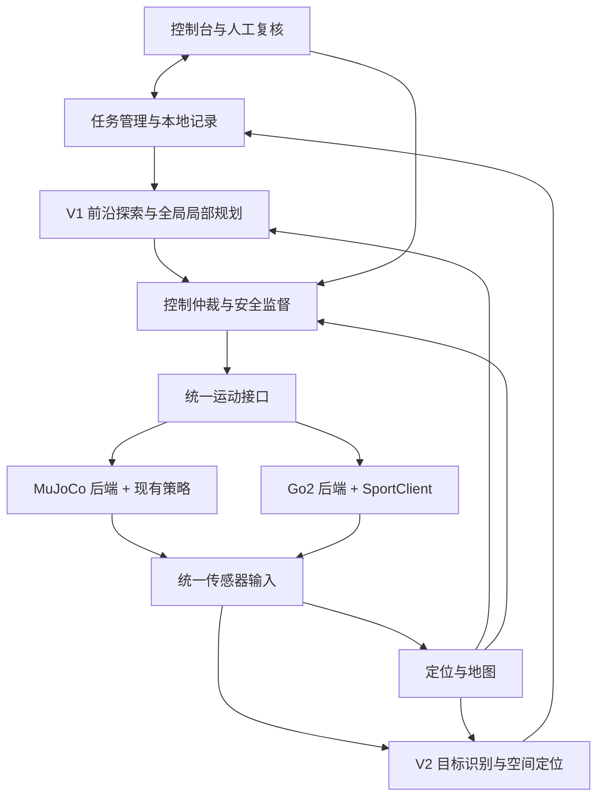

# 废墟智援：MuJoCo 仿真与 Go2 实机复现实施方案

文档修订：v0.2（保留原文件名）　｜　日期：2026-10-31　｜　状态：待实施、待设备验证

本文依据 [PRD v0.2](./废墟智援_PRD_v0.1.md)、[技术设计 v0.2](./废墟智援_技术设计文档_v0.1.md)、[宇树 SDK 兼容性与比赛接口缺口](./宇树SDK兼容性与比赛接口缺口_2026-10-31.md)，说明如何利用当前 AIP 工程完成仿真，并把同一套任务系统部署到真实 Go2。需求编号、指标和业务接口沿用三份文档；新增文件、接口及配置均为实施建议，除明确标注的现有入口外，不表示已经实现。

## 1 实施路线与复现目标

首版采用“共享上层算法、分别适配运动与传感器”的路线：MuJoCo 使用现有 `go2_rl_lab` 行走策略，真实 Go2 拟使用经本机验证后的原厂 Sport 服务。V1的在线定位、建图、未知终点探索、规划、安全和记录通过统一接口复用；V2再增加目标识别与复核；速度上限、制动曲线、传感器标定和地形能力分别配置。

当前硬件固定为 **Go2 EDU 16 GB / 100 TOPS 拓展坞版本**。V1只用自带雷达、IMU与本体状态，D435i和MID360为后续选装，V1不使用。导航分[不背图版](./导航方案_不背图版.md)和[背图版](./导航方案_背图版.md)，先做不背图。产品阶段V1/V2与两种导航版本独立，多机协同仅为非必要拓展。

不背图V1的地图与终点位置均未知，算法通过前沿探索抵达终点；仿真由独立评估器按真值位置验收。实机终点验收尚未确认，先验证探索、地图、定位与分段通行，完整终点任务保留待验收。

这里的“实机复现”最终目标是：在对应场地与目标布置下，真实 Go2 完成同类任务，输出可比较的通行、识别和故障处置结果。它不要求两端逐时刻轨迹、关节动作或完成时间完全相同，也不能由一次仿真成功推导实机成功。

| 路线 | MuJoCo 端 | Go2 端 | 本项目安排 |
| --- | --- | --- | --- |
| A：上层任务迁移 | 现有研究策略执行速度命令 | 原厂 Sport 执行速度命令 | 首版主线；分别测量两端能力，使用共同已验证范围 |
| B：同一运动策略迁移 | 固定 ONNX、观测及电机模型 | 通过低层接口部署同一策略 | 后续独立工作包；须完成动力学、关节映射、实时性及保护验证 |

路线 A 无需先训练新步态，也无需先在 MuJoCo 中复刻全部官方 SDK 服务。若真实 Go2 原厂运控不能通过必需地形，应先记录能力缺口，评估路线或控制方案；不能仅增加一个“爬坡/切步态”的函数名就宣称解决。当前固定版本 Go2 Python SportClient 不提供 `BodyHeight()`、`FootRaiseHeight()`、`SwitchGait()` 或 `TrajectoryFollow()`，具体核对见 [SDK 审计](./宇树SDK兼容性与比赛接口缺口_2026-10-31.md)。

## 2 当前工程基础与待补内容

| 项目 | 当前证据 | 下一步 |
| --- | --- | --- |
| 场景 | 12×10 m 场地、坡道、S 弯、分岔、五组固定乱石、三类隧道 | V1增加自带雷达等效观测、IMU、动态障碍与布局变化；V2再加目标及相机；区分建模假设与官方尺寸 |
| 行走 | `MujocoGo2.move/stop/step/get_state`，固定混合地形策略 | 封装持续运行的后端，增加完整状态、能力及运动反馈 |
| 简单任务 | 定距前进、转向及组合任务 | 改成基于状态订阅的非阻塞任务，并补导航、制动和取消流程 |
| 运动验证 | 既有报告包含基础检查及三种确定地形片段 | 扩展为分赛段、多次、随机扰动和全场验收 |
| 感知与业务 | 尚无完整雷达观测、SLAM及探索导航；目标/复核属于V2 | 按第 4 至 7 章实现 |
| 实机 | 已选Go2 EDU 16 GB / 100 TOPS拓展坞；固件、自带雷达型号与数据接口待核验 | 先做第 8 章设备及接口验证 |

本次仅核对代码、配置和既有报告，没有重新执行运动测试。SDK 审计记录的是较早的 13 项基础检查；[控制器说明](../go2_controller.md)另记录速度范围更新后的 14 项检查。历史报告不能拼接为新一轮验收成绩。已验证的首组 5 cm 台阶、12° 上坡片段及第五组 4–12 cm 固定乱石，也不覆盖完整下坡、其他乱石、动态碎石或全场通行。

当前配置的平地指令范围 `vx∈[-4.5,4.2] m/s`、`vy∈[-1,1] m/s`、`wz∈[-3,3] rad/s` 是策略输入校验范围，不是实机许可速度，也不是全赛道能力包络。任务限速须单独配置，不能直接照搬这些上限。

### 2.1 已有入口：先复验基础运动

以下命令在 AIP 项目根目录执行，仅运行本地 MuJoCo，不连接真实 Go2：

```bash
# 已有环境直接运行；缺少依赖或模型时按 docs/go2_controller.md 重建。
bash scripts/run_go2.sh --headless --task forward --distance 0.5 \
  --report output/controller/implementation-baseline.json

bash scripts/run_go2.sh --headless --scene rescue --task forward --distance 0.3 \
  --report output/controller/implementation-rescue-start.json

.venv/bin/python scripts/verify_go2_controller.py
.venv/bin/python scripts/verify_go2_terrain.py
```

运行前归档需要保留的旧报告，验证脚本会更新默认输出文件。`run_mujoco.sh`、`run_rescue.sh` 是站立展示入口；比赛行走开发用 `run_go2.sh`。上述命令通过只代表运动基线通过，不代表导航、目标探测或实机已经实现。

## 3 先建立两端一致的工程边界

### 3.1 模块架构



仿真和实机后端互斥启动。首版让项目 ROS 域与机器人原生 DDS 网络通过适配进程连接；运动只有一个出口。机器人侧计算单元运行定位、规划、安全、SDK 适配与记录，操作台运行浏览器。机器人侧部署目标为已选16 GB / 100 TOPS拓展坞，核验系统、SDK和权限后冻结环境；开发机配置不直接等于机载部署配置。

### 3.2 拟增工程文件

保留现有 `aip/` 及脚本，用以下增量结构实现技术设计中的逻辑包，不新建另一套项目根目录：

```text
AIP/
  aip/
    contracts.py                 # 拟增：后端无关的数据类型和能力契约
    sim_robot.py                 # 已有：物理及策略实现
    tasks.py                     # 已有：简单任务，后续提取纯决策逻辑
  ros_ws/src/
    rescue_interfaces/           # 消息、service、action
    rescue_adapters/             # MuJoCo / Go2 后端及传感器转换
    rescue_localization/         # 自带雷达/IMU里程计、在线SLAM、质量判断
    rescue_terrain/              # 高程、三维占据、通道判定
    rescue_navigation/           # 前沿/区域搜索、A*、局部速度、分支退出
    rescue_perception/           # V2检测、目标定位、关联
    rescue_mission/              # 任务与赛段状态机
    rescue_safety/               # 仲裁、看门狗、锁存
    rescue_recorder/             # 事件、证据、导出
    rescue_bringup/              # 模式选择、自检、启动与退出
  gateway/                       # 技术设计 10.4 的 API
  console/                       # V1任务/地图/监控/复盘，V2复核
  configs/{robots,sensors,missions,algorithms}/
  tests/{contracts,scenarios}/
```

上表除已有文件外均待创建。先实现一条端到端链路再拆分，避免只有空包。复杂里程计优先通过适配器接入已有实现；选型必须通过实际扫描格式、时间戳、外参、算力和 ROS 环境验证，不能仅凭算法名称冻结。

### 3.3 统一接口及错误语义

| 拟定接口 | 输入或输出 | 实施要求 |
| --- | --- | --- |
| `get_capabilities()` | 命令、传感器、版本、能力包络、验证记录 | 不支持与未验证分别表示 |
| `apply_motion(command)` | `SafeMotionCommand` | 校验来源、epoch、序号、单位、有效期及方向覆盖 |
| `request_stop(reason)` | 停止请求结果 | 发起后进入 `STOPPING`，不能立即报告停稳 |
| 状态订阅 | 六自由度位姿、速度、健康、采样时间、坐标及有效性 | 运动反馈与定位状态分开，未知值不填假零 |
| `MotionFeedback` | 发送结果、接受是否已知、运动状态 | 区分 `SENT/ACCEPTED/REJECTED/EXPIRED` 与 `MOVING/STOPPING/STOPPED/UNKNOWN` |

统一反馈须补齐 SDK 审计提出的 `acceptance_known`，不要仅沿用技术设计中的一个 `accepted` 布尔值。实际 Go2 的 `Move()` 使用无应答调用；其返回成功只能记录发送成功，不能伪造服务端逐条接受确认。`StopMove()` 有请求应答，但停稳仍需遥测判断。[官方 SportClient 固定源码](https://github.com/unitreerobotics/unitree_sdk2_python/blob/814556d15970dd2ecf1c9984e845ca02ab07e206/unitree_sdk2py/go2/sport/sport_client.py)

将现有任务循环改为“新状态 → 计算意图 → 发布 → 等待下一状态”。上层不再调用 `step()`，也不直接访问 `MjData`。仿真服务自行推进物理；真实 Go2 自行执行原厂运控。距离任务应根据剩余距离和实测制动包络提前降速；任务取消、异常和退出均进入等待停稳流程，而非固定等待 1.5 秒即判成功。

## 4 MuJoCo 仿真闭环如何实现

### 4.1 固定环境和控制器

沿用 Python 3.12、MuJoCo 3.3.6 及当前依赖锁文件，行走模型固定到 `go2_rl_lab@6c95d9feef4814c25eb6536e61bb38e1d1d718d4`，权重哈希与配套参数由 [go2_controller.json](../../configs/go2_controller.json) 管理。ROS 2 Jazzy 为开发机拟建上层基线，拓展坞实际系统及驱动到机核验，必要时独立适配进程连接；官方 Jazzy 安装资料对应 Ubuntu 24.04，不能据此推导宇树所有驱动均已支持 Jazzy。[ROS 2 Jazzy 平台资料](https://github.com/ros2/ros2_documentation/blob/jazzy/source/Installation/Ubuntu-Install-Debs.rst)

当前策略周期 20 ms、物理步长 5 ms，每次策略周期包含 4 个物理步。先保持这组参数，避免在接 ROS 时同时改变运动基线。单一物理线程拥有运行中的 `MjData`；消息回调只投递带时效的命令，渲染线程或进程使用一致性快照，禁止与物理线程无保护地共享可变数据。动力学继续通过关节控制量与 `mj_step` 推进。[MuJoCo Python 接口](https://mujoco.readthedocs.io/en/3.3.6/python.html)

必须区分两种运行方式：

| 方式 | 用途 | 时间与指令 |
| --- | --- | --- |
| 实时仿真 | 接 ROS、控制台和外部控制进程，模拟实机链路 | 物理节拍按单调时钟调度，监测实时因子及超期；观测使用仿真采样时间 |
| 离线加速仿真 | 批量回归、数据生成 | 所有算法按仿真调度；不接外部人工速度，不直接混用墙钟控制客户端 |

ROS 仿真节点统一 `use_sim_time=true`，`/clock` 来源为 `data.time`。外部控制链看门狗和租约采用单调时钟。现有 300 ms 仿真时间失效机制继续作为底层保护，但不能替代拟建 200 ms 外部命令时效检查；有效运动必须同时满足二者。200 ms 是设计初值，需测量后冻结。暂停、时间回退或重启时撤销租约、清空过期命令并锁存暂停状态。

### 4.2 V1：匹配自带雷达的观测输出

先核实实际Go2自带雷达型号、点云接口、扫描时序和IMU来源，不将D435i或MID360作为V1输入。仿真按机载位置、FOV、近远盲区和遮挡生成有限观测；模型中传感器外形与质量按实际装机更新。自带雷达具体型号不能由旧资料直接推断。[官方Go2设备资料](https://www.unitree.com/go2/)

| 数据 | 实现任务 | 校验 |
| --- | --- | --- |
| IMU | 明确site及轴向，采样gyro/accelerometer，注入噪声与偏置 | 静止、转动、倾斜，重力/比力语义与实机一致 |
| 状态 | 按名称转换关节、本体姿态、速度及健康 | 关节顺序、坐标、单位、时间；估计与真值来源分开 |
| 自带雷达等效点云 | 在传感器坐标中生成射线方向，按扫描时序求首次表面交点，加入量程、漏检、噪声及延迟 | 近远面、遮挡、自体过滤、点密度、点/帧时间；不能透墙或查询隐藏完整地图 |
| 后向/顶板覆盖 | 由上述雷达实际覆盖计算，不新增理想传感器补盲 | 倒退走廊、侧壁和顶板缺失时方向禁行或UNKNOWN |
| RGB-D | V2再添加相机渲染、深度、内外参和对齐 | V1不发布、不订阅、不作启动依赖 |

射线查询以传感器可观测表面为依据，透明/反光等材料误差根据实测建模。不能用整场碰撞几何直接生成自主占据图；感知必须受到FOV和遮挡限制。若真实点云不提供点级时间，先验证所选里程计如何处理，不伪造MID360格式。

预算沿用IMU 100 Hz、点云10 Hz、定位50 Hz、局部规划20 Hz、安全输出50 Hz，均需在本体上测量。当前step一次推进20 ms，100 Hz IMU应在5 ms子步内每2步采样，不能复制同一状态充数。相机/检测频率属于V2预算，V1不占用其计算资源。MuJoCo传感器实现依据见[传感器定义](https://mujoco.readthedocs.io/en/3.3.6/XMLreference.html#sensor)。

### 4.3 补充场景和真值隔离

继续由场景生成器和layout.json管理世界几何。V1新增布局扰动、动态障碍、雷达噪声/丢帧工况，终点区域只供评估端使用；V2再补目标与光照。场景生成配置不得直接交给自主算法。

动态障碍通过独立物体轨迹及碰撞几何实现横穿、封路和靠近。若用运动学障碍，只用于指定轨迹的避障验证，不用其碰撞响应评价真实质量或碰撞损伤。固定乱石与可滚动碎石是两个测试集，后者需要独立动力学建模与验证。

评估进程读取机器人真值位姿、终点区域、障碍和碰撞。自主进程只读模拟传感器、本次在线地图与许可边界，禁止读取route_waypoints、中心线、完整几何、旧地图、隐藏种子和终点坐标/距离。仿真加载MJCF与自主算法分进程，配合文件权限和消息白名单隔离。

终点验收由评估器判断真值参考点进入区域，发一次终止事件请求停止；保持在区域内且停稳才计成功。事件不含终点坐标或距离，不用于选路奖励。真值调试定位必须标ground_truth_debug，不计入正式SLAM和探索成绩。
### 4.4 定位与坐标闭环

统一建立 `map → odom → base_link → sensors`。V1完成六自由度本地估计、在线建图、回环与质量状态；背图版随后增加先验地图匹配；坡道上的 roll、pitch 和高度不能省略。不背图的`map`从起点初始化，`odom` 保持短时连续，每条 TF 只有一个发布者。

实施顺序为：真值调试定位验证导航接口 → 传感器估计替换真值 → 加入噪声、延迟及短时失效 → 用评估端真值计算误差。若使用本体已经融合 IMU 的里程计，避免再次把同一 IMU 当作独立信息融合。定位 `LOST` 或全局跳变时暂停；前沿、分支和路径保留map_revision，校正后重验；V2目标记录也按版本处理。

## 5 导航与各赛段如何落地

优先完成未知地图且未知终点的位置验收任务。先从在线地图提取可达前沿，以信息增益、已知路径成本、风险与重访惩罚选择观察位姿，再通过新观测推进。前沿必须落在可到达的已知自由侧，不按隐藏终点方向打分；若雷达已看见整片区域但机体未访问，按访问掩码继续生成区域子目标；前沿与未访问区域均无候选才记NO_FRONTIER，超时单列，均非到达。背图版后续加载先验，终点未知时采用未访问区域/分支搜索，已知终点实验单列。

1. **地形输入**：点云去自体点、转换到采样时刻坐标、局部地面拟合，生成 2.5D 高程网格与局部三维占据；未知和过期空间单独编码。
2. **全局路径**：A* 使用障碍、坡度、台阶、粗糙度与净空代价；超出包络属于硬禁止。对角边、路径平滑结果都重新检查碰撞。
3. **局部控制**：初期固定 `vy=0`，采样前向速度和偏航速度，预测短时轨迹并检查运动中的三维扫掠包络；无可行候选时停止。
4. **执行监督**：监测位置进展、横向偏差、姿态、数据年龄和停止距离；每个赛段具有超时、取消及失败原因。

| 赛段 | 具体实现 | 仿真到实机的迁移重点 |
| --- | --- | --- |
| 上下坡 | 使用坡度与本体能力限制速度，分别验证上坡、坡顶、下坡及坡底过渡 | 原厂控制器单独测坡面速度、滑移和下坡制动；上坡成功不能代替下坡 |
| S 弯 | 路径跟随加方向相关扫掠体积检查，约束角速度与加速度 | 用装载传感器后的真实包络，测转向延迟与侧滑 |
| 死胡同 | 地图连通性加无进展判定，记忆失败分支，沿最近安全路径退出 | 倒退能力和后向观测必须均有效；旧轨迹不代表当前后方仍为空 |
| 五组乱石 | 每组有独立地形参数、速度限制和测试记录，再测试连续通行 | 记录石块是否固定、表面摩擦和载荷；按实测能力决定能否进入 |
| 隧道 | 入口停止或低速观察，估计截面下界，判断 `PASSABLE/BLOCKED/UNKNOWN` | 当前无共同已验证低姿态能力，按实际站姿、摆腿和传感器突出部分判定 |
| 动态障碍 | 更新动态占据，优先减速/停下，再规划；阻塞超时请求处理 | 用实机端到端时延、制动包络及障碍接近速度配置阈值 |

圆管采用截面或三维占据与包络求交，不能只比较宽高。隧道 1 的拒绝依据必须来自观测尺寸和包络，不能硬编码编号；圆管和方涵也需有可通过、不可通过、观测不足三类样本。

停止预算初期采用 `d = v*T_total + v²/(2*a_verified) + margin`，之后替换为按速度、地形及载荷测得的保守停止距离表。动态障碍另加接近距离和不确定度。自由空间不足时限制速度；`a_verified` 未知时不能使用理论电机能力填值。

## 6 V2：目标探测、定位与回传

本章目标与图像链路全部属于V2。V1先实现任务/地图/轨迹/事件回传与导出，不等待相机、检测器或复核页面。V2再评估本体相机、可选D435i及图像与雷达关联；MID360仅在确有定位/覆盖缺口时另行选择。

### 6.1 探测到坐标

采用可替换检测器接口，先冻结类别、输入预处理、权重哈希和检测阈值。以下以V2选定RGB-D方案为例，处理链为：最新 RGB-D 配对 → 检测 → 多帧确认 → 可靠深度簇 → 采样时刻 TF → 目标关联 → 证据落盘。技术设计的“最近 5 次有效推理至少 3 次命中”仅作为初值。

对已对齐、去畸变且深度是 optical 轴向距离的观测，按 `X=(u-cx)Z/fx`、`Y=(v-cy)Z/fy` 反投影，再应用观测时刻的 `T_map_camera`。目标框需排除边缘及背景深度；深度、TF 或定位质量不满足条件时仍保存图像，但 `position_valid=false`、JSON 坐标为 `null`。

目标关联结合位置不确定度、类别、图像跟踪及一对一匹配；临近的两个目标不能按一个固定距离阈值直接合并。感知确认、人工复核及位置有效性独立保存。按比赛类别上报生命目标及人工复核结果。

### 6.2 数据与实机视觉差异

MuJoCo 图像先验证接口、遮挡逻辑与定位数学；它不能独立证明真实弱光、纹理及材质下的识别效果。V2准备期采集所选视觉传感器的正常/弱光样本，按场景或采集序列分开训练、验证、测试，禁止相邻帧随机拆分后计为泛化能力。

仿真可改变光源、材质、V2相机噪声及遮挡，增强鲁棒性；真实弱光需记录可复现照明条件并单独测试。原厂前向RGB不等于RGB-D；V2按验证结果选择D435i或相机与点云关联，缺少可靠深度时目标位置无效。V1不用目标深度，也不因此升级选装硬件。

### 6.3 控制台与记录

复用技术设计10.4：V1先交任务、指令、地图/轨迹、事件补传和导出，V2增加目标查询/复核。机器人侧 SQLite 单写入服务保存任务和事件，证据文件完成落盘后再提交索引；目标更新与事件在同一事务中提交。

控制台显示数据年龄、位置有效性、执行是否确认和复核历史。断线后按 `event_seq` 补传事件并去重，不能补发缓存速度。暂停按钮先显示等待确认，实际停稳后才更新停止状态。完整任务还需导出轨迹、目标、事件、证据及版本清单。

## 7 控制保护必须先于全场自主运行

| 条件 | 实现行为 | 验证证据 |
| --- | --- | --- |
| 接管 | 安全 > 人工 > 自主；撤销旧 epoch，等待停止后授予新租约 | 同时提交人工/自主命令，只有授权来源生效 |
| 命令过期 | 校验源时间和剩余有效期，转发不续期；末端再检查接收年龄 | 旧序号、延迟包、重复包均不能续跑 |
| 观测或定位失效 | 禁止依赖缺失观测的方向运动，关键失效请求停止 | 丢帧、遮挡、定位跳变下的停止时序 |
| 控制进程退出或断链 | 依靠机器人侧独立、已验证的看门狗进入平台支持的停止状态 | 适配进程退出、链路中断及发送中断测试 |
| 失联恢复 | 故障锁存；同步状态、复检及人工确认后恢复 | 重连和进程重启均不自动运动 |
| 结束任务 | 撤销租约、请求停止、确认或超时报警，然后结束记录 | 导出保留最后实际运动状态，不将 UNKNOWN 标为 STOPPED |

停稳判据至少包含新鲜遥测、平移速度/角速度阈值、持续时间及姿态健康，阈值按本体测量后冻结。接到零速度、SDK 返回成功或仿真窗口关闭都不等于实机停稳。严重姿态故障的动作遵守实际平台验证流程，不能通用地用 `Damp()` 或清零力矩代替安全停止。

原生指令超时保护目前未经本项目实机验证，必须作为接入门槛。Python 的 `finally: stop()` 只能处理部分正常退出路径，无法覆盖进程被杀、主机失电或通信断开。

## 8 真实 Go2 的接入步骤

### 8.1 先建立设备档案

| 需确认的信息 | 产物及阻塞范围 |
| --- | --- |
| 已选Go2 EDU 16 GB / 100 TOPS拓展坞；待核验固件、SDK 权限、Sport 服务版本 | `robot_profile`；接口不可用时阻止自主运动接入，不预设所有型号开放相同能力 |
| 计算设备系统、架构、可用资源与部署权限 | 固定运行环境；验证推理、点云和控制周期 |
| 自带雷达/IMU/状态接口与实际后向/顶部覆盖 | V1 sensor_profile；缺点云阻止相关建图导航，缺覆盖禁止对应动作；RGB-D仅V2 |
| 原厂运动模式、遥控器优先级、断链和进程退出行为 | 控制权与保护验证报告；不能用 SDK 初始化成功替代 |
| 电源、机械安装、载荷、散热及线缆 | 实际载荷配置与完整包络；安装变化后重验相关能力 |

硬件选型已确定，但到机系统、固件与传感器接口未核验，因此本文不指定IP、网卡名、已开放功能或已验证速度。实机能力字段未验证时保持空值并阻止相关自主动作启动。

### 8.2 软件环境与网络

固定 SDK 基线为 `unitree_sdk2_python@814556d15970dd2ecf1c9984e845ca02ab07e206`。其 README 指定 Python ≥3.8 和 CycloneDDS 0.10.2；实际安装须冻结依赖并做发现、订阅、服务调用及断链测试，不以包安装成功判定兼容。[官方 SDK 安装说明](https://github.com/unitreerobotics/unitree_sdk2_python/blob/814556d15970dd2ecf1c9984e845ca02ab07e206/README.md)

宇树 ROS 仓库的本次固定版本列出 Foxy/Humble，并推荐 Humble；本项目 Jazzy 组合需要额外验证。先在目标环境做兼容性试验，若失败，可以把 SDK 放在独立进程/环境，通过项目定义且有时效校验的 IPC 接到上层；若点云驱动也依赖 Humble，则需验证跨环境数据桥，或统一调整上层部署基线。不能让不同 ROS 发行版无验证地直接互通。[官方 ROS 固定说明](https://github.com/unitreerobotics/unitree_ros2/blob/668d1ec5a05d1c38d3306bdca7d59f2ba3581a88/README.md)

实机首次接入使用设备实际支持的链路和明确指定的网卡；仿真用回环或隔离网络。项目 ROS 域、SDK 的 DDS domain/interface 分别配置并核验，不能只设置 `ROS_DOMAIN_ID` 就假定 SDK 流量已隔离。首次仅订阅状态与传感器，确认时间、帧率、数据有效性及重启行为后再开放运动出口。

### 8.3 实机适配器实现

将唯一有效的 `SafeMotionCommand` 转换为 `SportClient.Move(vx,vy,wz)`，停止请求转换为经验证流程中的 `StopMove()`；根据错误码更新发送状态。SDK 连接与初始化负责通信，自检和任务状态机负责是否允许运动，初始化完成不得自动开始任务。

| 原始输入 | 项目转换 | 需要现场确认 |
| --- | --- | --- |
| Sport 状态，SDK 常见 `rt/sportmodestate` | 本体运动状态、速度、姿态及健康 | 实际主题、频率、字段坐标、时间与有效性 |
| LowState | IMU、关节、电量及本体健康 | 型号字段、单位、轴向和可用标志 |
| ROS 点云，官方示例 `/utlidar/cloud` | `/sensors/points` | frame、扫描时间、FOV、近距盲区和噪声 |
| 相机及深度驱动（V2） | `/sensors/rgb/depth/camera_info` | 对齐、尺度、标定、曝光和采集时间 |

`SportModeState.position` 不直接当作比赛地图坐标；先确认其语义，再由定位与标定建立到 `map` 的关系。四元数、机体/世界速度和 IMU 重力语义分别测试。SDK 原生 `rt/...` 名称与 ROS `/...` 表示不混写。

原厂遥控器、App、避障服务和自主程序都可能影响运动。确定唯一正常运动命令入口及独立停止优先级，实测接管冲突；不把 `SwitchJoystick()` 当作完整租约机制，也不因启动自主控制就随意关闭停止手段。原厂避障若启用，记录状态并测试其与上层规划的相互影响。

### 8.4 第一次运动的测试顺序

按 PRD 的受监护和隔离要求，在平整、空旷试验区执行：

1. 核对设备状态、实际停止通道、遥控器接管及本地日志，保持待命。
2. 从低速短距离前进、转向、停止开始；具体速度在设备测试方案中批准并记录，不从仿真最大值起测。
3. 测速度跟随误差、启动延迟、转向误差、停稳时间与距离，同时保留指令和遥测原始时间。
4. 在适当试验条件下验证发送中断、适配器退出、链路断开及恢复后的默认停止。未通过时不进入全场自主运行。
5. 再分别开放倒退、侧移或特殊姿态；每项都要求运动、观测覆盖、停止和包络验证，不因 SDK 接受参数就自动启用。

## 9 如何缩小仿真与实机差异

### 9.1 两端分开建能力表

| 参数组 | 实机测量 | 仿真使用方式 |
| --- | --- | --- |
| 运动响应 | 各速度下的跟随误差、加速、转向与侧滑 | 用数据检验局部规划预测，必要时引入延迟或跟随误差模型 |
| 制动 | 按坡度、速度、载荷、电量区间测停止时间和距离 | 收紧安全预算；两端制动表分别保存 |
| 几何与载荷 | 机身、摆腿、传感器、线缆包络和安装质量 | 更新碰撞几何、外参及必要动力学参数 |
| 地形接触 | 坡面、石块尺寸、固定方式、表面条件及滑移 | 标定可观察参数，随机化范围来源于测量及不确定度 |
| 传感器 | V1雷达/IMU噪声、盲区、丢帧、时间与扫描畸变；V2加曝光 | 在合成观测或发布链路注入相应工况 |
| 计算与通信 | 观测到执行各阶段耗时及尾延迟 | 注入延迟和积压，测试看门狗与停止距离 |

路线 A 的控制器不同，即使调好摩擦和质量也不能证明两端步态等价。项目只在两端共同已验证的地形、速度、感知范围内声明复现；其他能力明确列为仅仿真或仅实机通过。

拟建配置示例，字段是契约示意，不是现有加载器支持的文件：

```yaml
schema_version: 2
feature_stage: V1
navigation_mode: online_unknown
prior_map: null
goal_pose: null
real_finish_policy: pending
runtime:
  mode: real                  # simulation 与 real 互斥
  use_sim_time: false
robot:
  profile_id: go2_edu_16gb_100tops_builtin_sensors
  backend: unitree_sport
  firmware_version: null
  native_watchdog_verified: false
  envelope_file: null
  braking_table_file: null
  verified_forward_limit_mps: null
  verified_reverse_limit_mps: null
  verified_slope_limit_rad: null
  verified_step_limit_m: null
  allow_reverse: false
  allow_lateral: false
  allow_posture_change: false
control:
  command_ttl_ms: 200
  operator_heartbeat_timeout_ms: 1000
  require_manual_resume: true
sensors:
  calibration_manifest: null
  rear_coverage_verified: false
  realsense_d435i_enabled: false
  mid360_enabled: false
perception:
  life_detection_enabled: false
```

任何必需能力或标定为 `null` 时自检失败；1000 ms 是操作台失联门槛，不能覆盖 200 ms 的运动命令时效。实际包络、阈值、状态新鲜度和停稳持续时间以带报告引用的配置冻结。

### 9.2 现实场地复建

优先按最终确认的场地配置复建 1:1 赛段。记录坡度、坡顶过渡、通道截面、S 弯宽度、石块位置/尺寸/固定方式、目标位置和照明。尺寸来自测量或官方参数；当前 `layout.json` 中的建模假设不能自动作为官方尺寸。

在场地建立独立测量基准供评估；不背图自主map从起点建立，不给算法完整测绘地图或终点坐标。背图版另做先验标定。V1轨迹/地图评估（V2另含目标）使用独立于机器人定位输出的测量方法，并记录测量误差；不能拿机器人自己的估计当作真值。外部标记若仅供评估，应与自主算法输入隔离，是否允许用于自主定位按赛事规则确认。

先搭平地、坡道、S 弯、死胡同、乱石、隧道的独立工位，再按路线拼接。缩小场地可用于联调，但改变通道尺度、坡度或石块尺寸后，应另标为简化工况，不能计入正式复现成绩。

### 9.3 四级迁移验证

| 级别 | 执行内容 | 进入下一级条件 |
| --- | --- | --- |
| L1 离线回放 | 用真实传感器记录运行V1定位、地图和规划（V2再加检测），运动输出接空接收器 | 数据契约、坐标、质量和算法输出可核查 |
| L2 实机旁路计算 | 机器人由已验证方式受控运动，自主系统只计算建议，不发送命令 | 对比建议与现场观察，关闭明显感知和路径错误 |
| L3 分段闭环 | 自主低速完成单工位，再扩展到各赛段 | 对应 T 用例达到经确认门槛，失败原因可复现 |
| L4 全场复现 | 固定版本、场地、目标与任务时限，V1完成探索、建图及导出；V2再加探测复核；实机终点规则未定时不计完整任务通过 | 仿真和实机各自形成完整验收报告 |

回放与旁路模式从进程和权限上禁用运动出口。真实数据回放通过只证明算法可处理这些记录，不证明实机闭环中的交互、延迟和运动能力通过。

## 10 若必须将同一 ONNX 策略部署到 Go2

此路线仅在原厂运控无法满足任务，或明确需要研究同一策略的 sim-to-real 时启动，不能作为主线的一步简单替换。

1. 核实目标 Go2 的低层控制权限、硬件差异及停止流程；按官方要求处理高层与低层控制互斥，不能同时让 Sport 和研究策略控制关节。
2. 对齐当前模型的 450 维输入：45 维单帧、10 帧历史，按观测项分块、块内从旧到新排列；验证角速度、重力投影、指令缩放、关节位置/速度与上次动作。
3. 显式映射 FL/FR/RL/RR 及每腿 hip/thigh/calf 到实机电机索引，核对符号、零点、限位和单位；禁止按数组下标猜测。
4. 保留 50 Hz 策略的时间语义，并按实际低层协议要求实现更高频的命令服务及超时处理。MuJoCo 的 200 Hz 物理积分频率不是实机低层发送频率的依据。
5. 对齐动作尺度、关节目标、PD、力矩/转速限幅和历史复位；不要未经验证直接照搬 `Kp=25/Kd=0.5`，也不要将主机 PD 力矩与电机内部 PD 重复叠加。
6. 完成无运动观测回放、输出检查、按平台规程开展受保护试验、低速平地及分地形验证，最后重新执行第 11 章实机验收。

固定策略、作者发布记录和仿真通过都不能替代本机型、固件及载荷下的验证。路线 B 的试验、保护和回退包单独管理；本文没有提供或执行低层实机运动脚本。

## 11 开发批次与验收

### 11.1 建议开发批次

| 批次 | 交付 | 门槛 |
| --- | --- | --- |
| 1 V1接口 | 设备档案、自带点云、状态、时效、停止反馈、持续仿真服务 | 不依赖选装传感器；任务与step解耦 |
| 2 V1地图 | 雷达等效仿真、IMU/TF、SLAM、地图/轨迹导出 | 真值隔离，定位与地图可独立测误差 |
| 3 V1探索 | 前沿、A*、局部避障、分支回退、独立终点位置评估器 | 未知地图与未知终点、非固定路线 |
| 4 V1迁移 | 未见布局、故障注入、实机L1–L4及版本冻结 | 仿真适用验收通过；实机终点未定仅报分项 |
| 5 背图版 | 先验加载、重定位、区域搜索/目标规划、失配降级 | T18及与不背图同条件比较 |
| 6 V2识别 | 视觉方案、目标识别/坐标/证据/复核、可选设备评估 | 目标专项及导航联合回归 |

开发开始即验证实机自带雷达与控制接口，不等仿真完成才采集真实数据。排期依据设备接口和SLAM原型结果估算，不把V2目标链放在V1发布之前。

### 11.2 按修订 PRD 分阶段验收

V1执行T01–08、T11–17、T19的适用项；背图版另加T18；V2加入T09–10及目标链联合T14。Q05–07是V2目标指标，不能拿来验收V1机器人定位。Q08在V1统计导航/故障事件，Q12在V1检查地图/轨迹/日志，V2扩展目标证据。

新增Q13统计机器人ATE/RPE、静态地图误差、定位有效率、覆盖范围和终点误差；阈值须在独立正式测试前冻结，未冻结不宣称达标。Q14对至少10个未调参变化布局分别运行，建议至少8次自主成功且所有运行零碰撞；两版同传感器、同终点信息、同预算，失败全部保留。详细数值及T编号以[PRD第6–7章](./废墟智援_PRD_v0.1.md)为准。

仿真终点区域、参考点、容差及停稳规则在评估端冻结，算法看不到终点位置；仅按独立评估成功才计到达。实机规则尚未确认，当前不能把探索试验结束或操作者停止自动算作完整比赛成功。

原有Q01–04、Q09–12继续按PRD使用；安全停下可通过故障用例，但不算到终点成功。Q09的接受时刻若不可观测，报告发送/RPC返回等可测量项，不伪造接受时延；跨设备未同步不直接相减计算单向时延。

### 11.3 一次正式复现实验的流程

1. 冻结阶段/导航版本、发布清单、场景、评估端终点、传感器标定、能力包络、指标及探索时限；V2另冻结目标布置。
2. 仿真和实机分别自检，确认默认停止、记录服务及版本一致性。
3. 人工启动任务，执行当前阶段任务，V1不背图清空历史且不提供终点坐标；所有接管、超时和失败原样保留。
4. 任务结束请求停止并核对反馈，完成证据及数据库归档。
5. 独立评估端按相同定义计算指标，比较两端差异，指出环境与控制器差异。
6. 若据失败样本修改参数，则生成新版本并重新测试受影响用例，旧失败记录不删除。

每次运行保存 `task_id`、源码提交及未提交差异快照、依赖、SDK/固件、权重哈希、MJCF 和场景配置、随机种子、标定、实机载荷、地图来源、终点验收来源（V2另含光照）、原始观测、指令、反馈、事件及视频引用。随机种子相同不保证跨硬件动力学逐位一致。

## 12 V1交付与待确认项

V1交付：不背图未知终点探索、自带雷达/IMU建图定位、地图和轨迹导出、仿真与实机运动适配、暂停接管、独立仿真终点评估器、回归与故障报告。背图版随后独立交付，V2再加生命目标识别。完整比赛launch目前尚不存在，文中拟建文件和配置不是已实现软件。

硬件选型及不背图优先已确定，不再作为待决事项。待核验自带雷达型号/数据接口、固件和拓展坞环境；待赛事确认场地细节、目标类别、先验权限、线上平台和实机终点验收方式。实机终点未定不阻止探索/建图/定位分项验证，但阻止宣称完整实机起终点验收通过。


下一批最小交付应锁定为：**统一运动契约 → 持续运行MuJoCo服务 → 时效和停止确认 → 自带雷达等效观测/IMU → 在线SLAM与地图导出 → 前沿探索 → 独立位置验收**。同期开通Go2只读点云/状态采集，V1全过程不依赖D435i、MID360或目标识别。
