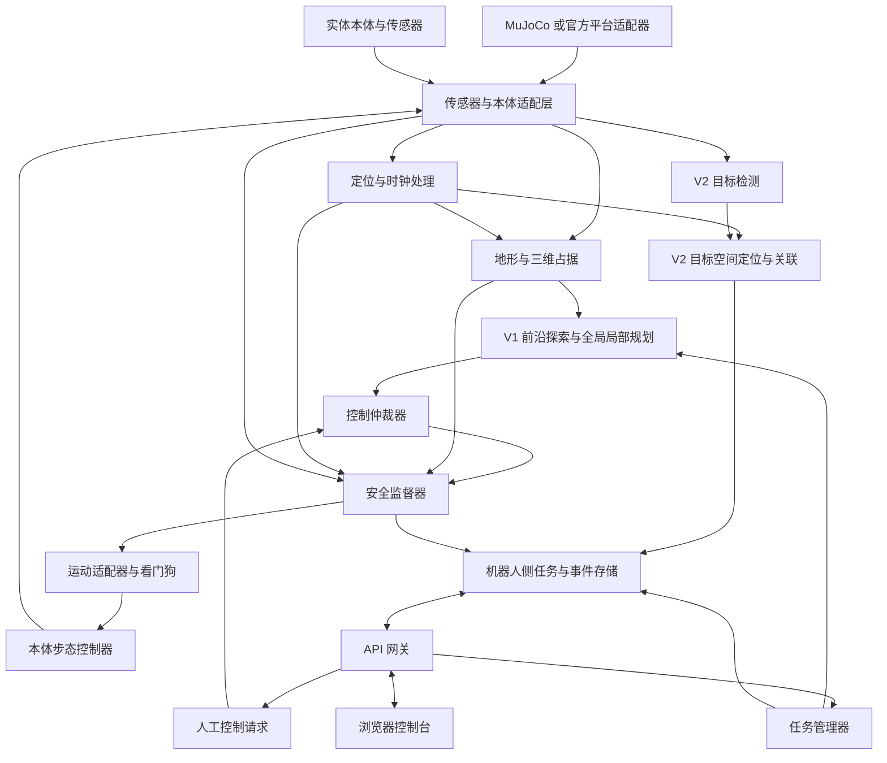
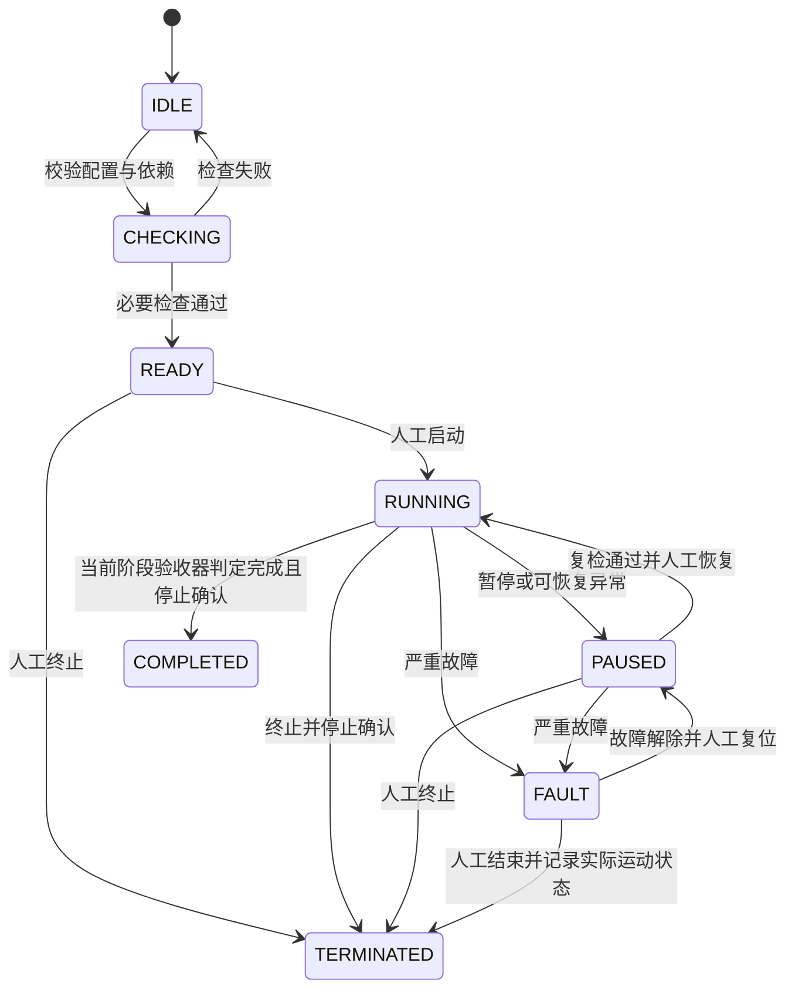

# 废墟智援四足机器人搜救系统技术设计文档

文档修订：v0.2（保留原文件名；产品阶段为 V1/V2）

日期：2026年10月31日\
状态：技术评审稿  
关联需求：[废墟智援 PRD v0.2](./废墟智援_PRD_v0.1.md)

本文按修订后的 PRD 分阶段实施：V1 使用单台 Go2 EDU 16 GB / 100 TOPS 拓展坞版本及自带雷达、IMU和本体状态，先完成不背图、未知终点探索、建图定位和导航；仿真终点由独立评估器按位置验收，实机终点规则待确认。V1 不使用 D435i、MID360，不依赖视觉或检测器。V2 再加入生命目标识别、目标定位和复核。导航另保留后续背图版，多机协同仅为非必要拓展。所有运动请求经过统一仲裁和安全检查。

本文描述拟实现的设计，不表示相关代码、设备或性能已经交付。赛事要求沿用 PRD；技术选型、运行频率和参数初值为团队设计方案。本体型号与拓展坞配置已选定；官方平台接口、固件、自带雷达具体型号和场地规格确认后，应更新适配配置及性能预算。

## 1 设计目标与边界

### 1.1 设计目标

1. 在统一场景配置下，完成坡道、S 弯、死胡同退出、五处乱石及隧道判断的任务闭环。
2. V1 从空地图开始在线定位与探索，终点位置不向自主端提供；V2 再实现生命目标证据与复核。
3. 将定位异常、观测过期、控制失联、通道不可通行等情况转为明确状态及处置动作。
4. 通过统一接口复用仿真与实机上层逻辑，保留配置、模型及原始观测以复现实验。
5. 对应 PRD 的 FR01 至 FR16、Q01 至 Q14 和 T01 至 T19（按版本/阶段适用），形成可追溯的实现与验证关系。

### 1.2 实施前提与能力边界

本体适配必须提供经过验证的速度跟随、站立保持和停止能力。上层路径规划不直接产生关节力矩，也不承担落足点优化或全身动力学控制。若所选虚拟或实体机器人没有可用步态控制器，须先完成控制器集成；不能用移动模型坐标或直接设置机体速度替代足式运动验证。

首版全局规划使用平面路径，局部通行使用高程、坡度和三维占据检查补充约束，适用于本赛题的单层赛场。首版不处理多层楼板、上下重叠通道和复杂攀爬。乱石通行能力由底层控制器的实测能力包络限定，超过范围时停止或选择其他合法路线。

V1 交付导航、在线地图、机器人定位和记录。V2 交付比赛生命目标识别与人工复核；多机协同不纳入两阶段必需交付。文中第8章及目标/图像专用接口均属于V2，不作为V1启动依赖。

### 1.3 关键技术决策

| 决策 | 首版方案 | 选择理由及约束 |
| --- | --- | --- |
| 机器人通信 | ROS 2，机器人侧节点协作 | 统一传感器、坐标变换、任务消息及记录方式 |
| 本地仿真 | MuJoCo 3.3.6，通过项目自定义 ROS 2 适配器接入 | 复用现有 Go2 MJCF 模型与废墟场景，用于开发与回归；官方线上平台单独接适配器 |
| 运动控制 | 高层导航加本体既有步态控制器 | 将导航与关节控制的责任分开 |
| 定位与地图（V1） | 自带雷达/IMU六自由度里程计和在线SLAM；背图版后续增加先验匹配 | 坡道及机体俯仰不能按纯平面运动处理 |
| 通行规划 | 不背图前沿选择 + 已知自由区域A* + 局部速度采样；背图版增加先验规划 | 模块边界清晰，可针对四足包络及地形约束修改 |
| 目标识别（V2） | 可替换的轻量检测模型，端侧推理 | 目标类别与权重许可确认后冻结具体模型 |
| 目标定位（V2） | 验证后采用 RGB-D 或相机与雷达关联，加观测时刻坐标变换 | 无有效深度或位姿时保留发现，位置标记无效 |
| 操作台 | 浏览器界面加本地 API 网关 | 页面展示及人工复核独立于运动闭环 |
| 数据存储 | 机器人侧 SQLite、证据文件及 rosbag2 | 支持断线缓存、事务提交及离线复盘 |

## 2 环境与部署架构

### 2.1 参考软件环境

开发机仿真基线采用 Ubuntu 24.04、Python 3.12、MuJoCo 3.3.6，上层模块拟使用 ROS 2 Jazzy。Go2 EDU 拓展坞的实际系统、架构、驱动和SDK依赖到机核验，不能把开发机环境当作已验证的机载环境；必要时以独立适配进程连接不同环境，并验证协议和时效。MuJoCo 版本与项目现有依赖清单保持一致，通过官方 `mujoco` Python 包加载 MJCF 模型、推进物理仿真并提供可视化；ROS 2 通过项目适配器接入，不依赖仿真器专用的现成 ROS 桥。ROS 2 Jazzy 的 Ubuntu 24.04 安装方式见 [ROS 2 安装资料](https://raw.githubusercontent.com/ros2/ros2_documentation/jazzy/source/Installation/Ubuntu-Install-Debs.rst)，MuJoCo 接口见 [MuJoCo 3.3.6 Python 文档](https://mujoco.readthedocs.io/en/3.3.6/python.html)。该版本为项目冻结基线，不代表当前最新版本。

| 层次 | 技术方案 | 版本冻结方式 |
| --- | --- | --- |
| 物理仿真及场景 | MuJoCo 3.3.6、Python 3.12、MJCF，复用 Unitree Go2 模型 | `requirements-mujoco.txt`、`requirements-mujoco.lock.txt`，固定上游模型提交及场景哈希 |
| 控制及点云处理 | C++、ROS 2 `rclcpp` | 固定编译器、ROS 包版本和提交号 |
| 感知及训练工具 | Python、PyTorch，导出推理权重 | 固定依赖、模型哈希、输入尺寸和预处理配置 |
| 部署推理 | 首先使用已验证的本地推理后端；ONNX 为可选导出格式 | 验证导出前后输出及精度，再决定是否启用 |
| 网关及复核 API | Python、FastAPI、WebSocket | 固定 Python 依赖及 API schema |
| 前端 | TypeScript、Vue 3、Vite | 锁定依赖文件并离线打包 |
| 任务记录 | SQLite、JSON、JPEG/PNG、rosbag2 | 对导出包建立文件清单和校验和 |

具体算法库、检测器、GPU 后端以及机器人 SDK 在设备兼容性测试后固定，不预先承诺跨硬件通用。训练环境和比赛运行环境分开，比赛版本不需要联网下载模型。

项目已具备本地 MuJoCo 环境及废墟场景，安装、版本和启动入口见 [MuJoCo 环境说明](../mujoco_setup.md) 与 [场景使用说明](../rescue_scene.md)。现有独立仿真入口直接调用 MuJoCo，ROS 2 适配层仍为待实现设计，不代表已经完成全部传感器、导航或实机链路。若使用 WSL2、虚拟机或容器，先验证图形渲染、DDS 发现、设备转发与时钟行为，再作为正式运行环境。

### 2.2 部署单元



单机仿真时，各单元可部署在同一台 Linux 主机；实机时，定位、规划、安全、控制及关键记录运行在机器人侧计算单元。控制台失联不影响机器人执行本地安全停止。操作台只发送任务与人工控制意图，不直接访问电机驱动。

MuJoCo、官方平台与实机适配器必须互斥启动。MuJoCo 适配器负责加载模型、推进物理步、采样传感器、发布 ROS 2 消息并接收控制请求；自定义任务、安全及控制消息在 ROS 侧处理。高层速度请求先经步态控制器转换为关节控制量，再按执行器定义写入 `data.ctrl`，通过 `mujoco.mj_step` 推进动力学，不能直接修改机体位姿模拟行走。宇树 `unitree_mujoco` 可作为 Go2 模型与底层 SDK2 接口参考，其底层接口不等于现成的高层速度控制器。[MuJoCo Python 接口](https://mujoco.readthedocs.io/en/3.3.6/python.html)、[Unitree MuJoCo](https://github.com/unitreerobotics/unitree_mujoco)。

V1 先实现IMU、关节/本体状态及与自带雷达匹配的三维观测，按第10章验证。点云由射线扫描模型生成，匹配视场、遮挡、近距盲区和时间；RGB-D渲染、相机标定和图像链路留到V2。不默认加载机器人模型就具备完整传感器。物理步长、步态控制周期、ROS 发布频率与渲染频率分别配置，渲染不能阻塞物理及安全控制循环。

### 2.3 固定硬件与阶段输入

本体选定 Go2 EDU 16 GB / 100 TOPS 拓展坞版本。16 GB / 100 TOPS 为用户指定配置，实际性能仍需测量；本体自带雷达的型号、驱动、扫描格式和开放接口按交付设备冻结，不写死旧批次参数。[官方 Go2 页面](https://www.unitree.com/go2/)可用于设备资料核对，不能代替本机验证。

| 输入/设备 | 阶段 | 适配要求 |
| --- | --- | --- |
| 自带雷达点云 | V1 必需 | 帧/点时间、扫描模式、FOV、盲区、机体遮挡、外参、有效率；缺失阻止导航 |
| 自带IMU、本体状态/里程计、关节 | V1 必需或按估计器选择 | 轴向、单位、时间、融合相关性及健康；不可用时降级策略须明确 |
| 后向及顶板观测 | V1 按动作检查 | 从自带雷达实际覆盖证明；不足禁止倒退或判为通道UNKNOWN，不能假设360°覆盖无盲区 |
| 控制反馈、电量及停止通道 | V1 必需 | 发送、接受与停稳分开；原生超时保护实测 |
| 本体相机 | V1 非依赖，V2评估 | V1可仅作人工观察，缺相机不影响导航自检 |
| RealSense D435i | 可选，V1不使用 | V2决定是否用于RGB-D及目标定位，标定后启用 |
| MID360（MID-360） | 可选，V1不使用 | 后续按定位缺口决定，不能默认已安装或用其扫描格式代替自带雷达 |

自带点云无法获取时先解决接口，不悄悄改用选装传感器。V1运行依赖清单不包含视觉、检测器或RGB-D；V2逐项追加。

## 3 模块职责与运行预算

### 3.1 逻辑模块

| 模块或包 | 职责 | 主要输出 | PRD 关联 |
| --- | --- | --- | --- |
| `rescue_interfaces` | 消息、服务、动作及错误码定义 | 接口契约 | 全部 |
| `rescue_adapters` | 仿真、传感器和本体接口转换 | 观测、状态、控制确认 | FR01 FR02 FR07 |
| `rescue_localization` | 本地里程计、全局校正及质量判断 | 位姿、TF、定位状态 | FR02 FR03 FR09 |
| `rescue_terrain` | 高程、占据、地形分类及通道判断 | 地形网格、通行约束 | FR03 FR04 FR06 |
| `rescue_navigation` | 全局规划、局部轨迹及退出恢复 | 运动候选、导航结果 | FR03 至 FR06 |
| `rescue_perception`（V2） | 目标检测、深度投影、跨帧关联 | 目标观测及候选事件 | FR08 FR09 FR11 |
| `rescue_mission` | 任务状态、赛段推进及控制权请求 | 任务状态、动作目标 | FR02 FR10 FR13 |
| `rescue_safety` | 命令仲裁、健康监测、保护与锁存 | 唯一有效运动命令、故障 | FR04 FR07 FR11 |
| `rescue_recorder` | 事务记录、缓存、证据及导出 | 本地任务库、导出包 | FR10 FR13 |
| `rescue_gateway` | API、会话、消息同步和操作审计 | 控制台数据及请求结果 | FR10 FR13 |
| `rescue_console` | 监控、复核、任务配置与回放 | 用户界面 | PRD 第5章 |
| `rescue_sim`、`rescue_bringup` | 场景生成、节点启动与模式隔离 | 可复现启动配置 | FR01 FR02 |

初期保持点云、推理、控制和网关为独立进程，避免推理或视频编码阻塞运动链路。后续仅在测量证明通信开销显著时组合节点，不预先追求复杂的分布式部署。

### 3.2 建议运行频率

| 链路 | 建议初值 | 队列及超时策略 |
| --- | --- | --- |
| IMU 接收 | 100 Hz，受设备能力约束 | 小队列，检测时间戳异常 |
| 三维观测及局部地图 | 10 Hz | 处理最新完整观测，过期数据弃用 |
| 里程计输出 | 50 Hz | 记录协方差与更新时刻 |
| RGB-D 接收（V2） | 15 Hz | RGB 与深度按观测时间配对 |
| 目标推理（V2） | 5 至 10 Hz | 待处理帧最多1帧，避免推理积压 |
| 全局规划 | 事件触发，最多2 Hz | 新目标、阻塞或地图变化触发 |
| 局部规划 | 20 Hz | 计算超时不复用过期指令 |
| 安全监督及控制输出 | 50 Hz | 独立定时器及本体侧看门狗 |
| 控制台心跳 | 10 Hz | 连续1秒无有效心跳触发监督失联 |
| 页面遥测 | 5 至 10 Hz | 允许合并展示，保留采样时间 |

这些数值是开发预算，须在目标硬件上测量。操作台心跳阈值与运动命令有效期分别管理：人工控制命令可以更早失效，不能等待1秒才停止继续执行的人工速度。

## 4 坐标系 时间与数据质量

### 4.1 坐标系约定

采用右手系，长度用米、时间用秒、角度用弧度。机体坐标为 x 向前、y 向左、z 向上；相机 optical 坐标为 z 向前、x 向右、y 向下。[REP 103](https://raw.githubusercontent.com/ros-infrastructure/rep/master/rep-0103.rst)。

```text
map
└── odom
    └── base_link
        ├── imu_link
        ├── lidar_link
        ├── camera_link
        │   └── camera_optical_frame
        └── rear_sensor_link
```

`odom` 保持短时连续，用于局部控制；`map` 用于任务路径与目标报告，允许全局校正。`map → odom` 由全局定位模块单独发布，`odom → base_link` 由本地估计器单独发布，不允许多个节点争用同一条 TF。[REP 105](https://raw.githubusercontent.com/ros-infrastructure/rep/master/rep-0105.rst)。

不背图 `map` 原点在起点初始化，不用完整场地真值对齐自主地图；背图版按先验标定对齐。仿真评估端另维护世界真值变换，不向自主端发布终点坐标。定位尚未对齐时不发布有效的全局目标坐标。局部避障使用连续的 `odom`，避免全局地图校正导致局部速度突变。

### 4.2 时间策略

传感器融合与 TF 查询使用采集时间，不能用检测结束时间替代。单机仿真所有相关 ROS 2 节点统一设置 `use_sim_time=true`，由 MuJoCo 适配器以 `data.time` 为时间源发布 `rosgraph_msgs/msg/Clock` 到 `/clock`，传感器消息使用对应采样物理步的仿真时间。实机使用设备时间到主机时间的已标定映射，多机误差超过阈值则阻止需要跨机时间比较的操作。

超时、租约和本地看门狗使用单调时钟；原始观测时间与墙钟用于重放及审计。仿真暂停或时间回退时，清空时序缓存、撤销控制租约并暂停任务；仿真恢复不能自动重放暂停前的速度命令。

V2 建议 RGB 与深度配对容差初值为30毫秒；点云、位姿及模型输出各自设过期阈值。阈值必须结合运动速度和误差验证，不能通过不断放大容差来掩盖同步问题。

### 4.3 数据有效性

所有模块输出至少包括 `stamp`、`frame_id`、`status` 和来源标识。数值存在不代表数据有效：深度空洞、非有限值、标定过期、位姿协方差超限、点云覆盖不足均须转换为显式质量状态。

位置无效时，JSON 使用 `null`，ROS 消息使用 `position_valid=false` 并禁止下游使用数值字段；不能用坐标零值或全零协方差表达“未知”。

## 5 定位与在线建图

### 5.1 本地运动估计

本地估计器融合 IMU 与可用本体里程计，输出六自由度 `odom → base_link`。若本体里程计已包含 IMU 融合结果，应选择其输出或明确相关性处理，避免将同一信息作为独立观测重复融合。

三维点云配准提供局部及在线地图约束。V1 先适配本体自带雷达的六自由度里程计/SLAM，核验点级时间、IMU来源、扫描方式和退化条件后冻结算法。不能将针对MID360的字段或参数直接用于自带雷达；无点时间时应选择并验证近似/算法和速度限制，不伪造数据。初期静止观测创建局部地图，运动中扩展；地图必须导出。候选算法通过实际机载环境验证，不把Jazzy构建成功当作实机已通过。

### 5.2 两个导航版本

- **不背图 `online_unknown`，优先**：每次正式冷启动清空历史地图和分支记忆，仅输入本体标定、允许边界和传感器；地图与终点位置均未知。在线SLAM构建地图，前沿探索选择可达观察位姿，局部导航持续验证自由空间。
- **背图 `prior_map`，后续**：加载合法、带版本和坐标的先验图，先完成初始重定位，再在线更新障碍。终点信息单独配置；默认对比仍不提供终点坐标，已知图中用未访问区域/拓扑子目标搜索，不能依赖不存在的未知前沿。只有明确提供终点的单独实验才直接规划到终点。

两版复用局部控制与安全模块，入口、地图来源和验收标签分开。背图失配降级后仍标为背图降级，不计作纯不背图成绩。详细行为见[不背图版](./导航方案_不背图版.md)、[背图版](./导航方案_背图版.md)。

### 5.2.1 未知终点的验收边界

仿真评估器独立读取机器人真值和终点区域，以位置进入、保持及停稳判定完成；只向监督器发终止事件，不向导航器发送终点方向、距离、坐标或奖励。实际完成区域、参考点、容差和停止规则在评测前冻结。探索无前沿或超时不是到达终点。

实机终点验收规则尚未确认。启动配置区分探索试验与完整比赛任务；规则未冻结时允许分项探索/建图/定位试验，不允许宣称完整实机终点任务已验收。

### 5.3 定位质量与降级

定位状态包括 `INITIALIZING`、`VALID`、`DEGRADED`、`LOST`。判断依据包含更新年龄、配准残差或匹配质量、协方差、位姿变化与 IMU/本体估计的一致性。

`DEGRADED` 时停止推进新赛段，是否允许限速短距离运动由已验证配置决定；`LOST` 时立即发起本体安全停止，并将目标全球坐标标为不可用。全局位姿出现跳变时暂停任务，重新验证路径、前沿和分支坐标；V2还需重验既有目标位置，不能静默挪动目标记录。

V2每个目标保留观测时刻的原始传感器引用、局部坐标、转换链和 `map_revision`。全局校正后由目标模块重新计算位置并增加版本；人工确认状态与坐标版本分开保存。

## 6 地形建模与通道判断

### 6.1 地图表示

| 数据层 | 内容 | 消费模块 |
| --- | --- | --- |
| 二维任务地图 | 边界、允许区域、已知墙体和赛段拓扑 | 任务管理及全局规划 |
| 2.5D 地形网格 | 地面高程、坡度、粗糙度、局部高度差、置信度 | 地形代价与步态配置选择 |
| 局部三维占据 | 地面上方障碍、顶板、管壁及机器人扫掠体积 | 隧道、近距避障及安全监督 |
| 动态障碍层 | 动态障碍位置、速度估计、时间和不确定度 | 局部轨迹预测 |

建议网格分辨率初值为0.05米，12×10米平面约为240×200个单元，仅表示网格规模，不包含三维地图、证据与日志资源。局部高程窗口和三维占据窗口采用有限范围滚动更新。

### 6.2 点云处理流程

剔除无效点及机体自身点 → 按观测时刻变换并进行必要的运动补偿 → 空间降采样 → 局部地面估计 → 网格统计 → 占据更新 → 生成通行约束。

地面估计使用局部平面或邻域高程拟合，不能只把固定高度以下的点视为地面。每个网格保存点数、更新年龄及估计不确定度；从未观测的空间与曾观测但已过期的空间均不能自动当作自由空间。

### 6.3 地形代价与能力包络

对网格计算归一化代价：

```text
C = w_occ*C_occ + w_slope*C_slope + w_step*C_step
  + w_rough*C_rough + w_clearance*C_clearance + w_unknown*C_unknown
```

所有权重非负。碰撞、超出最大已验证坡度、超过可跨越高度差、净空不足等条件是硬约束，不能靠其他低代价项抵消。软代价用于在可行路径之间比较风险及效率。

本体能力包络按步态和姿态分别存储：允许速度、角速度、加速度、坡度、局部高度差、机体高度范围以及停止距离曲线。包络来自分段测试，不直接照抄宣传参数。不存在已验证能力值时，对应困难地形默认不可自动通行。

### 6.4 隧道和限宽限高

在入口前建立候选通道坐标系，从多帧三维观测估计地面、侧壁和顶板。矩形通道以宽高进行初筛；圆管及不规则通道使用截面占据与机器人三维包络求交，不能只比较外接矩形的宽和高。

```text
有效宽度下界 > 当前姿态扫掠宽度 + 左右安全余量
有效高度下界 > 当前姿态扫掠高度 + 上下安全余量
预测运动扫掠体积 ∩ 已占据或关键未知体积 = 空集
```

“下界”需扣除观测、定位和姿态误差。包络覆盖机身、传感器、腿部摆动与调姿过渡，而非只有静态机身尺寸。只有底层已提供并验证调姿接口时，规划器才可请求降低机体高度。

输出 `PASSABLE`、`BLOCKED` 或 `UNKNOWN`，附最小间距和判断依据。`UNKNOWN` 时停在入口外补充观测或请求接管。隧道1应由实际尺寸与包络得到拒绝结论，不能仅硬编码编号；同时设置可通行对照样本，验证系统没有一律拒绝。

## 7 路径规划与运动执行

### 7.1 未知终点探索与全局路径规划

V1先从已知自由区域与未知区域的边界提取前沿，聚类并筛除不可达、低质量及已失败候选。在已知自由侧生成可站立、可停止且满足三维包络的观察位姿。评分综合当前地图估计的信息增益、已知路径代价、风险与重访惩罚，不使用终点真值方向或距离。

子目标经过地图版本与时效校验后送到全局规划；到达观察位姿再更新点云、地图与前沿。动态封路可等待、换前沿或受控回退；每个分支限制重试。同时维护机体实际访问掩码，对已观测但未经过的可达区域生成访问子目标，避免只有位置验收的终点被雷达提前看见后漏访。前沿与未访问区域都无有效候选时输出NO_FRONTIER，预算耗尽输出EXPLORATION_TIMEOUT，二者都不能转换成COMPLETED。背图且终点未知时切换到未访问区域/分支选择器；终点已提供才使用终点目标。

首版在允许区域及地形代价网格上使用 A* 生成路径，启发式使用不高估基本移动代价的距离函数。每条相邻网格边进行碰撞检查；对角移动检查角点，避免从两块障碍之间穿越。路径简化和平滑后必须重新验证净空及地形约束。

平面规划使用保守膨胀保证基本可行性；S 弯和隧道等区域由局部轨迹根据姿态与多边形包络精检。保守膨胀导致狭窄通道不可达时，不得直接缩小到低于机体包络，应进入受限通道模式或请求人工处理。

当当前导航子目标不可达、路径持续失效或新障碍阻断时重新规划。首版以0.5秒作为单次全局规划软超时初值，超时不输出部分未经验证的路径，并记录 `PLAN_TIMEOUT`。

### 7.2 局部速度采样

局部规划器以当前速度、控制周期和加速度限制建立候选速度集合，预测未来约1.5秒的短时轨迹。初版常规模式固定横向速度 `vy=0`，使用前向速度和偏航角速度；侧移仅在本体、感知覆盖及专项测试通过后开放。

处理顺序：

1. 根据坡度、粗糙度、净空和控制器状态确定速度及步态配置上限。
2. 生成满足加速度约束的候选轨迹，包含停止候选。
3. 以时间采样方式检查三维包络、地形硬约束和预测障碍占据。
4. 对可行轨迹计算路径偏差、目标进展、净空、地形风险与指令变化代价。
5. 输出最优候选；没有可行运动轨迹时输出停止意图及失败原因。

预测障碍运动不确定或观测不足时扩大障碍区域并降低速度，不依赖恒速预测作为唯一保护。轨迹预测间隔必须结合最高速度和最小障碍尺寸验证，防止离散检查漏过碰撞。

### 7.3 停止距离与动态避障

建议以以下结构初始化停止距离预算，最终使用实测包络替代：

```text
d_required = v*T_total + v^2/(2*a_brake_verified) + d_margin
```

`T_total` 包含观测年龄、感知、规划、通信和控制执行延迟；`a_brake_verified` 是当前地形和姿态下验证过的制动减速度，不能使用电机理论值。对于移动障碍，还须加入其可能接近的距离及不确定度。

机器人前方已验证自由空间不足以覆盖停止预算时，安全监督器限制或禁止加速。停止动作应遵循本体支持的姿态保持机制；发送零速度不等于已经停止，更不等于切断动力。

### 7.4 赛段行为（按观测触发，不按固定路线编号）

| 赛段 | 行为 | 无法继续时的处理 |
| --- | --- | --- |
| 上下坡 | 根据坡度限制速度，保持本体允许姿态 | 姿态或控制反馈超限则安全停止 |
| S 弯 | 减速、约束转角与机体扫掠区域 | 无可行轨迹时暂停并补充观测 |
| 死胡同 | 确认分支无进展，保存分支状态及退出路径 | 后方不可观测则请求人工接管 |
| 五处乱石 | 逐区验证地形并选择已验证步态配置 | 不跨越能力包络，不以地图代价代替落足能力 |
| 隧道 | 入口判断、必要时受控调姿、低速通行 | 净空未知或不足则拒绝进入 |
| 动态障碍 | 减速或停止，待安全后改道 | 持续阻塞转为等待人工处理 |

### 7.5 死胡同与倒退恢复

以在线分支拓扑、当前探索子目标可达性和近期位移共同判断死胡同，排除短时遮挡及正常等待。进入时保存已通过的局部轨迹，但保存轨迹不代表退出时仍无障碍。

倒退前重新扫描后方走廊，验证全段扫掠体积及停止距离，随后沿最近安全轨迹低速退出。过程中持续更新后方观测；后方数据过期或新障碍出现立即停止。退出后为失败分支设置带原因和版本的临时禁入状态；仅在新的有效观测证明条件改变后解除。

恢复尝试次数及无进展时间设上限，超过上限转为暂停，避免反复前进后退。人工接管也受后方空间和安全保护约束。

## 8 V2：生命目标识别、空间定位与关联

本章是V2设计，不创建V1运行依赖。V1自检、日志、导航和导出不等待相机/检测器。V2评估本体相机及可选D435i，深度方案可采用经标定的RGB-D或图像与雷达关联；MID360是否选装由独立定位/观测缺口决定。下文RGB-D链路为选定该方案后的实现方法。

### 8.1 模型与数据流程

数据登记来源和许可 → 按场景或采集序列拆分训练、验证、测试集 → 标注目标类别及遮挡 → 训练基线检测器 → 冻结阈值 → 导出及一致性校验 → 在目标设备评测 → 登记模型版本。

具体检测器在官方目标定义和算力确定后选择。模型接口固定输出类别、置信度、二维框、推理耗时及原始观测编号，避免上层依赖某个模型特有输出。每个发布包包含权重哈希、类别表、颜色通道顺序、归一化、缩放与填边方式。

弱光方案先比较原图、固定预处理及受允许补光条件，选择能够提高独立验证集效果的方案。预处理必须与训练或验证条件一致，原始图像仍保留；不能只凭图像看起来更亮就认定识别能力提高。

### 8.2 推理与候选确认

接收最新对齐 RGB-D 帧 → 校验时间与图像质量 → 预处理及推理 → 将输出框还原到原始图像 → 类别及阈值筛选 → 跨帧关联 → 生成确认候选。

建议初值采用最近5次有效推理中至少3次一致观测确认目标，最终根据速度和漏检情况调整。候选确认与人工确认分别建模，不能把模型跨帧确认标记为人工复核通过。

### 8.3 三维位置计算

在目标框或可用目标掩膜中提取有效深度，剔除边缘、无效值及明显背景离群点，选取空间一致的深度簇。不能直接对整框求平均，因为框中可能包含大量背景；深度簇不可靠时位置无效。

对于已经去畸变且深度为 optical 轴向距离的像素观测：

```text
Z = depth_m
X = (u - cx) * Z / fx
Y = (v - cy) * Z / fy
p_map = T_map_camera(t_capture) * [X, Y, Z, 1]^T
```

若设备提供的是沿光线距离而非轴向深度，应先按相机模型转换。查询观测采集时刻的 TF；转换不可用时允许短时有界等待，超时则输出 `position_valid=false`，不能用当前位姿凑出坐标。

位置定义为目标可见表面代表点，不默认代表人体质心。评测前须统一该定义与官方真值定义。位置不确定度可通过观测噪声和位姿噪声的一阶传播或标定实验估计，不以检测置信度代替米制误差。

### 8.4 目标关联与去重

同一任务内使用 `target_id` 标识目标，逐次观测使用独立 `observation_id`。关联优先结合空间距离及不确定度、类别、时间、二维跟踪和可用外观特征；使用门限和一对一匹配，避免多个邻近目标被同一轨迹吸收。

缺少有效位置时，仅维护短时图像轨迹，不凭相似类别跨长时间全局合并。重新获得可靠位置后再尝试关联。人工拆分或合并必须保留原始记录及审计历史。

### 8.5 目标状态

```text
感知状态：CANDIDATE → CONFIRMED → LOST
复核状态：PENDING → CONFIRMED_TARGET / FALSE_ALARM / PENDING
位置状态：VALID / INVALID / STALE
```

三个维度独立保存。目标离开视场不会删除已确认记录；位置失效不抹去证据；人工标为误报不删除原始观测。

## 9 任务状态 控制权与保护

### 9.1 任务状态机



V1仿真由独立位置评估器判终点，V2另要求配置中的目标任务完成；实机验收规则待定时探索试验结束不标为完整比赛COMPLETED。

`COMPLETED` 和 `TERMINATED` 不恢复为运行，继续作业创建新任务。故障解除不自动恢复自主控制。停止未确认时界面保持 `STOP_PENDING` 的运动状态，不可仅因任务结束就宣称机器人已停止。

### 9.2 控制权租约

只有控制仲裁器可以向安全监督器提交生效命令，优先级为安全保护、人工控制、自主控制。每次控制权变化生成递增 `control_epoch`，命令携带 `lease_id`、`sequence` 及有效期。

人工接管流程：请求接管 → 撤销自主租约并更新 epoch → 请求安全停止 → 等待本体确认 → 授予人工租约 → 操作台才允许发送有效速度。恢复自主时撤销人工租约，重新校验定位、感知和路径，再授予新的自主租约。

租约校验失败、序号倒退、命令过期或来源不匹配均拒绝。仲裁器和本体适配器重启时撤销全部旧租约，默认保持停止；不能从持久化数据自动恢复旧的运动权限。

### 9.3 安全监督与看门狗

安全监督器以独立控制循环检查观测新鲜度、定位质量、碰撞预测、姿态、本体状态及任务授权。通过检查后限制速度、角速度及加速度，再输出本体命令。重复输出不得延长来源指令的剩余有效期；来源指令失效后，即使监督器进程仍在运行也必须转为停止请求。

本体适配器配置独立的命令看门狗，建议有效运动命令超时初值为200毫秒；操作台心跳1秒是监督连接阈值，两者不能混用。适配进程退出、断链或无法继续刷新命令时，由本体原生看门狗进入已验证的停止及支撑状态。如果本体不具备该能力，实机接入不能通过安全评审。

浏览器“停止”属于软件停止请求，不替代实体紧急停止通道。故障锁存、停止确认、人工复位分开记录；严重故障不因短暂恢复正常读数就自动清除。

### 9.4 故障处置矩阵

| 故障 | 立即动作 | 恢复条件 |
| --- | --- | --- |
| 定位丢失或突变 | 停止，冻结全局导航 | 定位稳定、路径重验、人工恢复 |
| 前方或倒退观测过期 | 禁止对应方向运动 | 新鲜观测覆盖扫掠区域 |
| 控制台失联 | 撤销人工租约，自主任务也暂停并请求停止 | 重连同步完成、人工确认 |
| 本体指令无反馈 | 触发停止并标记未确认 | 通道恢复、状态核对及人工复位 |
| V2推理积压或检测进程失败 | 丢弃过期帧，记录探测不可用；必需探测任务暂停 | 模型恢复、设备健康检查通过 |
| 地形超出能力范围 | 停止并报告不可通行 | 合法替代路线或人工结束 |
| 关键记录无法写入 | 停止推进任务并保留故障原因 | 存储恢复且一致性检查通过 |
| 姿态或动力异常 | 调用本体规定的保护动作 | 按本体流程人工处理及复位 |

## 10 消息与接口契约

### 10.1 ROS 2 主题

下表为项目拟定义的契约，不表示这些主题已经存在。自定义类型统一置于 `rescue_interfaces`。RGB、depth、camera_info、perception/observations仅V2要求，V1不订阅也不等待这些主题。

| 主题 | 类型 | 发布方 → 订阅方 | 建议频率 |
| --- | --- | --- | --- |
| `/sensors/imu` | `sensor_msgs/msg/Imu` | 适配器 → 定位、安全 | 100 Hz |
| `/sensors/points` | `sensor_msgs/msg/PointCloud2` | 适配器 → 地图、定位 | 10 Hz |
| `/sensors/rgb`、`/sensors/depth` | `sensor_msgs/msg/Image` | 适配器 → 感知 | 15 Hz |
| `/sensors/camera_info` | `sensor_msgs/msg/CameraInfo` | 适配器 → 感知 | 按相机配置 |
| `/localization/odom` | `nav_msgs/msg/Odometry` | 定位 → 规划、安全 | 50 Hz |
| `/localization/status` | `LocalizationStatus` | 定位 → 任务、安全 | 10 Hz |
| `/mapping/map`、`/mapping/status` | 占据/点云地图及MapStatus | 建图 → 探索、网关、记录 | 配置频率及快照 |
| `/exploration/state` | ExplorationState | 探索 → 任务、记录 | 事件及心跳 |
| `/terrain/grid` | `TerrainGrid` | 地形 → 规划、安全 | 10 Hz |
| `/navigation/path` | `nav_msgs/msg/Path` | 全局规划 → 局部规划、记录 | 事件触发 |
| `/control/auto_intent` | `MotionIntent` | 规划 → 仲裁器 | 20 Hz |
| `/control/manual_intent` | `MotionIntent` | 网关 → 仲裁器 | 人工控制时20 Hz |
| `/control/safe_command` | `SafeMotionCommand` | 安全监督器 → 本体适配器 | 50 Hz |
| `/robot/motion_feedback` | `MotionFeedback` | 本体适配器 → 安全、任务 | 50 Hz |
| `/perception/observations` | `TargetObservationArray` | 感知 → 目标关联、记录 | 5 至 10 Hz |
| `/mission/state` | `MissionState` | 任务 → 网关、记录 | 事件及心跳 |
| `/events/live` | `RescueEvent` | 记录服务 → 网关 | 事件触发 |

原始传感器采用小队列、及时性优先的 QoS；配置与状态快照可使用 reliable 加 transient local；运动指令使用 volatile，禁止通过持久化向新订阅者补发旧速度。可靠传输不替代命令时效及本地看门狗，发布和订阅端必须校验 QoS 兼容。[ROS 2 QoS 说明](https://raw.githubusercontent.com/ros2/ros2_documentation/jazzy/source/Concepts/Intermediate/About-Quality-of-Service-Settings.rst)。

`/events/live` 只负责实时通知，断线补传依靠持久化事件游标，不依赖 DDS 的缓存队列提供完整历史。

### 10.2 自定义类型关键字段

```text
MotionIntent
  header: stamp, frame_id=base_link
  task_id, source_id, lease_id, control_epoch, sequence
  issued_at, valid_for_ms
  linear_x_mps, linear_y_mps, angular_z_rps
  gait_profile_id, posture_profile_id

SafeMotionCommand
  motion_intent_fields
  command_id, safety_revision
  safety_status, stop_requested, reason_code

MotionFeedback
  stamp, command_id, send_status, acceptance_known, accepted, reject_reason
  actual_velocity, motion_state, controller_health
  # motion_state 区分 MOVING、STOPPING、STOPPED、UNKNOWN

TargetObservation
  observation_id, task_id, stamp, camera_frame
  class_id, confidence, bbox_xyxy, evidence_id
  position_valid, position_map, covariance, map_revision
  quality_flags, model_version

RescueEvent
  event_id, task_id, event_seq, occurred_at
  type, severity, entity_id, payload_version, payload
```

V1新增 MapStatus（map_id、revision、source、stamp、quality）、ExplorationState（frontier_id、状态、尝试次数、剩余预算）和阶段验收结果；终点真值不进入这些消息。字段均须固定单位、范围、默认值与错误行为。`TerrainGrid` 另含分辨率、原点、尺寸、逐格地形代价、有效掩码及更新时间；未知和禁行分别编码，不混用为同一数值。

跨进程命令应校验来源时间、时钟质量及源有效期；网关转发不能刷新已经过期命令的有效期。适配器还用本地单调时钟限制自接收以来的最大存活时间，拒绝未来时间异常及过期积压消息。

### 10.3 任务动作与管理服务

| 接口 | 形式 | 行为 |
| --- | --- | --- |
| `ExecuteMission` | ROS action | 目标为任务配置，反馈赛段与进度，结果为结束原因及数据索引 |
| `NavigateSegment` | ROS action | 执行赛段导航，取消后须等待停止反馈 |
| `ValidateConfiguration` | ROS service | 返回逐字段校验结果，不启动运动 |
| `RequestControl` | ROS service | 请求控制权切换，返回请求编号及待确认状态 |
| `ResetSafetyLatch` | ROS service | 仅在停止且故障解除后允许人工复位 |

接口返回成功仅表示请求被接受；实际控制权授予或停止完成以状态事件确认。业务动作持久化 `command_id`，重复调用查询同一操作结果，不重复启动任务。

### 10.4 控制台 HTTP 与 WebSocket

目标查询、目标复核为V2接口；V1先交任务、地图/轨迹、事件与控制。V1可新增 `GET /api/v1/tasks/{id}/maps` 获取地图元数据和版本文件、`GET /api/v1/tasks/{id}/navigation` 获取探索状态与路径；两者不返回隐藏终点真值。未启用的V2功能返回明确未启用状态，不能阻塞V1。

| 方法与路径 | 用途 | 关键返回或约束 |
| --- | --- | --- |
| `POST /api/v1/tasks` | 校验并创建任务 | `task_id`，保存配置哈希 |
| `POST /api/v1/tasks/{id}/commands` | 启动、暂停、恢复、终止、接管 | `202` 加 `command_id`，不代表已执行 |
| `GET /api/v1/commands/{id}` | 查询指令结果 | `PENDING/ACCEPTED/APPLIED/REJECTED/EXPIRED` |
| `GET /api/v1/tasks/{id}/events?after_seq=N` | 增量补传 | 按任务事件序号分页，返回下页游标 |
| `GET /api/v1/tasks/{id}/targets` | 查询目标 | 包含位置和复核的独立状态 |
| `PATCH /api/v1/targets/{id}/review` | 人工复核 | 操作人、备注、预期记录版本 |
| `POST /api/v1/tasks/{id}/exports` | 创建导出包 | 导出作业编号及完成状态 |
| `WS /api/v1/stream` | 心跳、遥测、事件及人工控制流 | 握手授权，控制命令带租约及序号 |

任务变更通过 `Idempotency-Key` 防止重试产生副作用，复核使用记录版本检测冲突。过期或控制权不符返回明确业务错误；字段错误返回校验明细；服务不可用时页面展示“未确认”，不能乐观显示成功。

```json
{
  "command_id": "cmd-demo-001",
  "task_id": "task-demo-001",
  "type": "PAUSE",
  "state": "APPLIED",
  "motion_state": "STOPPED",
  "reason_code": "OPERATOR_REQUEST",
  "control_epoch": 4
}
```

示例编号仅展示契约；生产编号使用唯一 ID。页面的实时流与历史回放使用独立会话和明显标识，回放会话无运动控制权限。

## 11 数据存储与断线一致性

### 11.1 存储责任

机器人侧记录服务是任务、地图、事件和执行结果的事实来源；V2再管理目标和复核。网关通过该服务查询或提交操作，不直接在另一台机器上复制写入数据库。首版使用单写入服务管理 SQLite，避免多进程争用业务状态。

| 表 | 主键及关键字段 | 用途 |
| --- | --- | --- |
| `tasks` | `task_id`、feature_stage、navigation_mode、finish_policy、配置哈希、状态、时间、结束原因 | 任务与版本快照 |
| `commands` | `command_id`、幂等键、任务、状态、epoch | 指令去重和执行追踪 |
| `maps` | map_id、task_id、revision、source、frame、路径/哈希、有效性 | V1在线地图及背图来源 |
| `navigation_runs` | task_id、模式、冷启动/恢复、探索状态、完成来源 | V1探索与验收记录 |
| `targets`（V2） | `target_id`、任务、感知/复核/位置状态、revision | 当前目标视图 |
| `observations`（V2） | `observation_id`、目标、时间、位置、模型、证据 | 原始发现及重定位依据 |
| `reviews`（V2） | `review_id`、目标、操作人、前后状态、备注 | 人工复核审计 |
| `events` | `event_id`、任务、`event_seq`、类型、载荷 | 单任务有序事件及补传 |
| `evidence`（V2目标证据） | `evidence_id`、相对路径、哈希、大小、完成状态 | 文件索引与一致性 |

对 `(task_id, event_seq)` 及客户端幂等键建立唯一约束。目标更新与对应事件在同一数据库事务中提交，再发送实时通知；通知丢失时客户端根据游标补取。事件只保证至少一次投递，接收端按事件 ID 幂等应用，不宣称跨链路恰好一次。

### 11.2 地图/证据文件及崩溃恢复

V1地图快照和轨迹文件同样采用临时文件、原子替换与索引提交；V2图像遵守下面流程。

图像先写入同目录临时文件，完成写入及必要同步后以原子重命名形成正式文件，再提交证据索引与事件。启动时扫描未完成索引及无索引文件，记录修复结果；不向控制台返回尚未落盘的证据引用。

数据库启用经验证的事务和同步配置；归档时使用数据库备份机制或在检查点后归档，不能只复制主数据库文件而遗漏活动日志。故障注入验证断电或进程退出后的数据库可打开性与事件关联完整性。

### 11.3 断线补传

控制台记住最后确认的连续 `event_seq`。重连后先获取任务和控制状态快照，再分页补取事件，按 ID 去重；订阅实时流期间发现序号缺口时继续补取。图片按需获取并校验哈希。

任何重连均不补发缓存的速度指令。任务操作可用同一幂等键查询原操作结果，但是否发起新的恢复命令必须由操作员明确确认。

### 11.4 容量和导出

原始传感器记录按测得带宽规划容量：`预计容量 = Σ码率 × 任务时长 + 证据及数据库 + 余量`。V1地图/轨迹和关键任务事件优先保留，V2另保留目标证据；高带宽 rosbag 使用分段与可配置保留策略。剩余容量不足时先告警和减少非关键记录，关键记录无法保证时暂停任务。

```text
exports/<task_id>/
  manifest.json
  summary.md
  config_snapshot/
  tasks.json
  maps/
  navigation.json
  localization_metrics.json
  targets.json                 # V2
  events.jsonl
  reviews.json                 # V2
  trajectory.csv
  evidence/                    # V2
  logs/
  metrics.json
```

`manifest.json` 包含 schema 版本、文件校验和、场景/本体/模型/源码版本及缺失项说明。自动导出不存在的实测指标时使用“未计算”，不能填入 PRD 建议值作为成绩。

## 12 场景配置与模型管理

### 12.1 配置分层

配置按场景生成、导航版本、功能阶段、本体、传感器、算法、任务分层组织，任务启动时解析为只读快照并生成哈希。涉及能力包络、坐标标定、控制超时及规划硬约束的参数禁止运行中随意修改；需要变更时先暂停、重新校验并登记新版本。

```yaml
# 结构示例；模式禁用项允许null，必需能力/验收字段为null则不能通过自检。
schema_version: 2
feature_stage: V1
navigation_mode: online_unknown
prior_map: null
route_waypoints: null
goal_pose: null
finish_policy: external_sim_position_judge
real_finish_policy: pending
runtime:
  mode: simulation
  use_sim_time: true
simulation:
  backend: mujoco
  version: "3.3.6"
  model_file: scenes/ruins_rescue/scene.xml # 仅仿真进程可读
  clock_source: data.time
scene:
  scene_id: rubble_reference
  version: pending_official_config
  bounds_m: [12.0, 10.0]
  grid_resolution_m: 0.05
  target_ground_truth: null  # 不在自主运行配置中提供答案
robot:
  profile_id: go2_edu_16gb_100tops_builtin_sensors
  verified_speed_limit_mps: null
  verified_reverse_limit_mps: null
  verified_slope_limit_rad: null
  verified_step_limit_m: null
  swept_envelope_file: null
  native_watchdog_verified: false
control:
  command_ttl_ms: 200
  operator_heartbeat_timeout_ms: 1000
  require_manual_resume: true
sensors:
  builtin_lidar_profile: null     # 到机核验后冻结
  realsense_d435i_enabled: false
  mid360_enabled: false
perception:
  life_detection_enabled: false # V2再启用，不是V1缺项
acceptance_profile: null        # 试验前冻结阈值；不含终点真值
```

按阶段检查必需字段：V1不要求视觉模型/深度；自带雷达与定位、能力、验收配置缺失，非有限值、单位不符或哈希不匹配均返回错误。终点区域在评估端独立配置，不在自主参数中提供。初值可用于仿真调试，但实机启动必须有通过记录对应的本体配置。

MuJoCo 场景采用 MJCF；当前废墟场景入口为 `scenes/ruins_rescue/scene.xml`，场地参数及建模假设保存在同目录的 `layout.json`。场景版本清单同时记录机器人模型来源与提交、网格及纹理哈希、物理步长、接触与摩擦参数、控制周期和随机种子；V1雷达/IMU配置随场景冻结，V2再冻结相机。几何验证与机器人实际通行验证分别记录，现有静态乱石不能作为可滚动或坍塌碎石能力的证据。

### 12.2 评测真值隔离

不背图自主端禁止读取完整场地几何、route_waypoints、中心线、旧地图、隐藏种子以及终点/目标真值。仿真进程负责加载世界并生成观测，独立自主进程只获得自带传感器等效流和许可边界，评估进程独立读取真值。通过消息白名单、进程/容器和文件权限隔离，不能只靠参数命名。

仿真评估器按位置判终点，可以发送一次结束事件；不得提供坐标、方向、距离或用于探索打分的奖励。正式冷启动清理自主历史缓存；恢复同一任务单独记录，不计入冷启动成绩。背图版显式允许先验地图，但目标真值仍隔离。

仿真真值可用于定位误差和碰撞统计；ground_truth_debug只用于开发，不计入V1建图定位或未知探索验收。同随机种子不保证动力学逐位一致。

### 12.3 训练及更新

首版发布模型在任务期间只读。V2收集复核数据后，在独立训练环境完成候选模型训练、回归及性能比较，再生成新版本；保留基线权重及回退包。

如果答疑确认“在线训练”为强制任务，增加受控适应流程：固定可更新参数范围 → 在仿真或停止状态采样 → 验证集与安全用例评估 → 人工批准候选切换 → 失败回退。未经验证的策略不得在运动中自动替换本体控制器。该扩展需要独立评审计算资源和赛事允许流程。

## 13 控制台与访问控制

V1控制台包括任务配置、运行监控和历史复盘，展示在线地图、定位质量、前沿和路径；V2增加目标告警/复核页面。地图展示 `map_revision`、位姿更新时间及定位状态；V2或可选人工观察视频展示采样时间，帧过期后明确标记，不能继续冒充实时画面。

按钮状态来自任务状态和权限。启动前展示检查结果；暂停和停止后显示“等待机器人确认”，收到执行反馈后更新。接管按钮在机器人完成切换确认前不启用人工速度控制。

V1设置操作员和只读角色，V2增加复核员。控制与复核请求均记录操作者，网关校验会话及 WebSocket 来源，部署在受限本地网络；需要跨设备时使用受保护链路及明确允许的主机。控制密钥和令牌不得写入导出包或源码示例。DDS 网络仅开放给受信任节点，外部浏览器不直接参与机器人 ROS 域。

实时视频编码、页面渲染和导出在低优先级工作线程或独立进程执行。资源紧张时优先降低视频帧率及点云展示密度，保留运动保护、定位和任务记录。

## 14 工程目录与启动流程

### 14.1 建议工程结构

```text
AIP/
  docs/
    prd.md
    technical_design.md
    interface_contracts.md
    test_plan.md
  ros_ws/src/
    rescue_interfaces/
    rescue_adapters/
    rescue_localization/
    rescue_terrain/
    rescue_navigation/
    rescue_perception/
    rescue_mission/
    rescue_safety/
    rescue_recorder/
    rescue_bringup/
    rescue_sim/
  gateway/
  console/
  configs/
    scenes/
    robots/
    sensors/
    algorithms/
    missions/
  models/manifests/
  tests/
    contracts/
    algorithms/
    integration/
    scenarios/
  tools/
    generate_scene.py
    evaluate_run.py
    export_task.py
  runs/
  releases/
```

该目录为后续工程建议，本文不会创建占位代码或改变现有项目结构。大模型文件、原始数据及运行日志通过清单管理，避免与源码混杂。

### 14.2 启动顺序

1. 读取版本清单，验证配置、模型及可写存储，创建任务记录上下文。
2. 启动安全监督、仲裁及本体适配器，确认默认停止及原生看门狗有效。
3. 启动 MuJoCo 仿真进程及 ROS 2 适配器、官方平台适配器或实机驱动，互斥选择运行模式；本地仿真校验 MJCF、执行器映射及 `/clock`。
4. 检查时钟、TF、传感器新鲜度及标定版本。
5. V1启动定位、在线建图、地形及探索，等待质量门槛；V2另启动目标感知。仿真评估器独立初始化，实机探索试验不伪装完整终点验收。
6. 启动规划与任务管理，保持 `READY`，不自行运动。
7. 启动网关和控制台，同步状态后由操作员发起任务。

退出时先撤销控制租约、请求停止并核对反馈，再关闭业务模块和记录服务。若无法确认停止，保留故障提示并按本体流程处理，不能只退出界面。

### 14.3 发布与恢复

每次发布固定源码提交、系统镜像或环境清单、ROS 依赖、MuJoCo 及 Python 依赖、模型、场景与本体参数。现场准备离线安装包及已验证版本；不依赖临场下载。重启后进入待命，扫描未完成任务并标记中断，操作员核对后创建新任务或按规定导出。

## 15 测试与性能验证

### 15.1 验证层次

| 层次 | 主要检查 | 通过证据 |
| --- | --- | --- |
| 接口契约 | 单位、时间、无效值、QoS、幂等及版本兼容 | 契约测试记录 |
| 算法单元 | 坐标投影、网格代价、碰撞检测、关联去重 | 可计算真值的输入输出对比 |
| 集成 | TF 链、控制租约、指令反馈、事件与证据事务 | 消息记录、数据库及执行反馈 |
| 场景 | PRD T01–T19按阶段执行；V1跳过T09/T10目标链，背图另加T18 | 完整运行记录与失败分析 |
| 故障注入 | 丢帧、延迟、时钟回退、进程退出、存储不足、断网 | 停止时序、状态与恢复记录 |
| 实机专项 | 制动、坡道、倒退、乱石、包络及看门狗 | 分地形能力包络及保护验证 |

### 15.2 关键算法测试

- 坐标投影：使用已知内外参和合成三维点，验证像素还原、轴向及变换方向；测试缺失 TF、错误深度尺度及时间偏移。
- 地形建模：坡面、台阶、悬空顶板和未知网格分别测试，验证不会将顶板投影为可通行地面。
- 隧道：矩形与圆形截面、临界间隙、姿态变化及传感器突出部位，分别检查拒绝和可通行情况。
- 局部规划：封路、横穿、突发靠近、对角角点及狭窄转弯，验证轨迹扫掠碰撞检查。
- 目标关联：同目标重复经过、相邻同类目标交叉、位置暂失及全局校正，检查合并和分离结果。
- 控制保护：旧 epoch、旧序号、失效租约、过期命令、进程重启和重连积压，均不得重新驱动机器人。
- 存储恢复：在图像落盘、事务提交和通知发送各阶段中断进程，验证补传和证据一致性。

### 15.3 指标计算

PRD 的 Q01–Q14按阶段使用：V1不统计Q05–Q07；Q13机器人定位/地图指标须试验前冻结阈值，Q14针对未见布局。V2再加入目标指标。评估工具从真实运行记录计算成功率、接管次数、碰撞、识别精确率与召回率、定位误差、回传时延和完整率。

V1报告ATE/RPE、静态地图表面误差、定位有效率、覆盖范围、探索耗时和重访次数；世界真值只在评估端使用。V2目标定位指标增加“有效定位目标数/应定位目标数”，防止只对少量易定位样本报告误差。若目标数量不足以稳定描述 P95，应同时给出样本数、最大值和原始分布，不用插值掩盖样本不足。

跨设备时延在时间同步误差可控时计算，并报告同步误差；否则分别报告本机阶段时延及操作台往返时间，不将未同步时间戳相减作为单向时延。Q09 的停止请求接受时延和机器人实际停止距离分别统计。

### 15.4 资源与调度

测量 CPU、内存、GPU 占用、各节点周期、队列年龄、磁盘写入和图像带宽，报告平均值与尾部延迟。安全循环不能等待推理或视频编码。对推理采用最新帧和有界队列，点云与视频避免无界缓存。

已选Go2 EDU 16 GB / 100 TOPS拓展坞，测量其实际功耗模式、内存、时延和持续性能；V1先测建图/导航，V2再测模型推理，不能由标称TOPS推导帧率。调整配置后重新执行受影响的验收用例。

## 16 实施顺序与需求追溯

### 16.1 分阶段实现顺序

| 批次 | 技术工作 | 门槛 |
| --- | --- | --- |
| 1 V1基础 | 自带雷达接口、状态、运动契约、停止与模式隔离 | 可观测且默认停止，不依赖选装硬件 |
| 2 V1地图 | 雷达等效仿真、IMU/TF、在线建图定位、地图导出 | 真值隔离，定位/地图误差可测 |
| 3 V1探索 | 前沿、A*、局部规划、回退与各地形 | 未知地图且未知终点运行，独立位置验收 |
| 4 V1冻结 | 未见布局、故障、实机分段与全场探索 | 适用T用例通过；实机终点未定则仅报分项 |
| 5 背图版 | 先验加载、重定位、区域搜索/目标规划、失配处理 | T18和共用回归，按终点信息条件独立比较 |
| 6 V2 | 识别、目标定位、复核、弱光及可选设备 | 目标链与导航联合验收 |


### 16.2 需求映射

| PRD 需求 | 主要设计章节 | 重点验证 |
| --- | --- | --- |
| FR01 场景与配置 | 第6、12、14章 | 配置校验、真值隔离、版本快照 |
| FR02 初始化 | 第3、4、9、14章 | 依赖失败时不启动运动 |
| FR03 自主通行 | 第5、6、7章 | 地形及本体能力包络 |
| FR04 动态避障 | 第6、7、9章 | 停止预算、扫掠碰撞及预测误差 |
| FR05 死胡同退出 | 第7章 | 后向观测、退出路径及重试上限 |
| FR06 隧道判断 | 第6、7章 | 圆管和方涵的三维净空 |
| FR07 运动保护 | 第9、10章 | 控制租约、原生看门狗及停止确认 |
| FR08 目标识别（V2） | 第8、12章 | 类别、弱光、训练测试隔离 |
| FR09 定位去重（V2） | 第4、5、8章 | 时间同步、深度投影及相邻目标 |
| FR10 回传复核（V2） | 第10、11、13章 | 游标补传、复核冲突和审计 |
| FR11 抗干扰 | 第4、8、9章 | 单路故障、观测过期及显式降级 |
| FR12 风险预警 | 第6、9章 | 事件证据及可观测能力边界 |
| FR13 记录导出 | 第11、14、15章 | 崩溃一致性、校验和及指标来源 |
| FR14 在线建图/机器人定位（V1） | 第4、5、12、15章 | T15/T16、Q13、地图导出 |
| FR15 未知终点探索（V1） | 第5、7、9、12章 | T15/T17/T19、Q14、仿真位置验收 |
| FR16 背图导航（后续） | 第5、7章及背图方案 | T18、先验失配及降级留痕 |

### 16.3 待冻结技术事项

1. 官方线上平台允许的通信接口、环境版本和提交方式，是否能够复用本地 ROS 适配层。
2. Go2 EDU已选定；待核验固件、原厂运控、自带雷达型号/接口、实际覆盖和原生看门狗。
3. V1自带传感器扫描模式、外参、时间与SLAM适配；V2再核验相机/深度及可选D435i、MID360。
4. 官方场地尺寸、目标类别、评测匹配规则、路线限制及是否允许先验地图。
5. 已选拓展坞的实际系统/驱动、持续性能、存储预算；V2模型许可和目标推理性能。
6. 实机终点验收方式（当前未确认）；仿真独立位置判定、机器人定位/地图误差阈值。
7. 在线训练的强制性、允许更新的对象及现场验证流程。

上述事项未明确时，先按模块契约完成可独立验证的部分；涉及本体能力或官方规则的结论保留待确认状态，不以默认参数冒充已验证规格。

## 17 资料依据

- 需求依据：[废墟智援 PRD v0.2](./废墟智援_PRD_v0.1.md)。
- 赛事依据：[用户提供的赛题规则](../references/废墟智援_赛题规则文档.pdf)，重点为第2至6页；官方要求与建议指标的区分见 PRD。
- 开发环境：[ROS 2 Jazzy 安装说明源码](https://raw.githubusercontent.com/ros2/ros2_documentation/jazzy/source/Installation/Ubuntu-Install-Debs.rst)、[MuJoCo 3.3.6 Python 接口与查看器](https://mujoco.readthedocs.io/en/3.3.6/python.html)。
- 本体模型与底层接口：[Unitree MuJoCo 官方仓库](https://github.com/unitreerobotics/unitree_mujoco)。
- 项目仿真基线：[MuJoCo 环境说明](../mujoco_setup.md)、[废墟场景说明](../rescue_scene.md)、[直接依赖](../../requirements-mujoco.txt)、[锁定依赖](../../requirements-mujoco.lock.txt)。
- 单位与坐标：[REP 103](https://raw.githubusercontent.com/ros-infrastructure/rep/master/rep-0103.rst)、[REP 105](https://raw.githubusercontent.com/ros-infrastructure/rep/master/rep-0105.rst)。
- 通信策略：[ROS 2 Jazzy QoS 说明源码](https://raw.githubusercontent.com/ros2/ros2_documentation/jazzy/source/Concepts/Intermediate/About-Quality-of-Service-Settings.rst)。

原技术资料核对日期为2026年10月28日；MuJoCo 平台及项目环境资料于2026年10月31日更新核对。本文的应用架构、算法组合、消息契约和参数初值为项目设计，不属于赛事官方指定方案。
