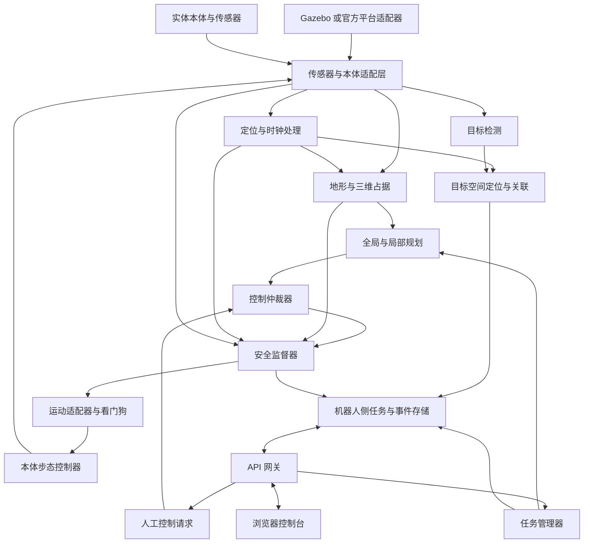
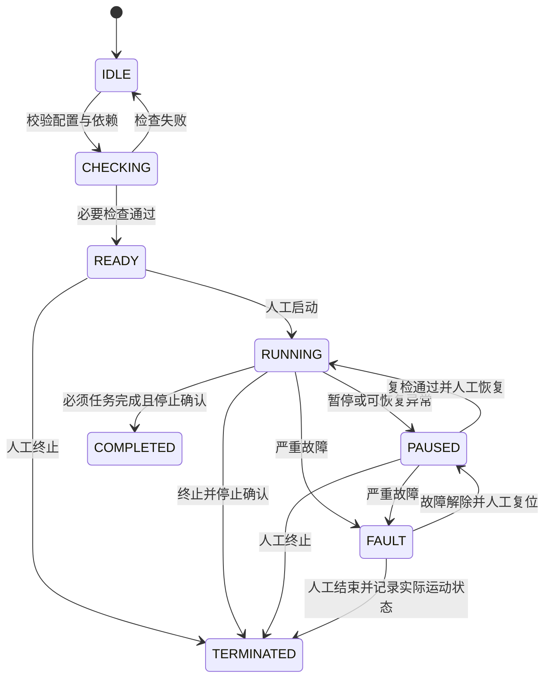

# 废墟智援四足机器人搜救系统技术设计文档

版本：v0.1  
日期：2026年10月28日  
状态：技术评审稿  
关联需求：[废墟智援 PRD v0.1](./废墟智援_PRD_v0.1.md)

本文将 PRD 中的自主通行、疑似生命目标探测、人工复核和任务记录需求分解为可实施的软件模块、算法流程、接口及验证任务。首版采用仿真优先、机载自主执行、操作台监督的架构；通行与识别并行运行，所有运动请求经过同一控制仲裁及安全检查后才能进入本体控制器。

本文描述拟实现的设计，不表示相关代码、设备或性能已经交付。赛事要求沿用 PRD；技术选型、运行频率和参数初值为团队设计方案。官方平台接口、本体能力、传感器型号和场地规格确认后，应更新适配配置及性能预算。

## 1 设计目标与边界

### 1.1 设计目标

1. 在统一场景配置下，完成坡道、S 弯、死胡同退出、五处乱石及隧道判断的任务闭环。
2. 发现疑似目标后生成带证据、时间和位置有效性的记录，在控制台完成复核。
3. 将定位异常、观测过期、控制失联、通道不可通行等情况转为明确状态及处置动作。
4. 通过统一接口复用仿真与实机上层逻辑，保留配置、模型及原始观测以复现实验。
5. 对应 PRD 的 FR01 至 FR13、Q01 至 Q12 和 T01 至 T14，形成可追溯的实现与验证关系。

### 1.2 实施前提与能力边界

本体适配必须提供经过验证的速度跟随、站立保持和停止能力。上层路径规划不直接产生关节力矩，也不承担落足点优化或全身动力学控制。若所选虚拟或实体机器人没有可用步态控制器，须先完成控制器集成；不能用移动模型坐标或直接设置机体速度替代足式运动验证。

首版全局规划使用平面路径，局部通行使用高程、坡度和三维占据检查补充约束，适用于本赛题的单层赛场。首版不处理多层楼板、上下重叠通道和复杂攀爬。乱石通行能力由底层控制器的实测能力包络限定，超过范围时停止或选择其他合法路线。

系统仅报告“疑似生命目标”及人工复核结果。气体检测、生命体征判断和结构坍塌预测不纳入无传感器支撑的默认能力。

### 1.3 关键技术决策

| 决策 | 首版方案 | 选择理由及约束 |
| --- | --- | --- |
| 机器人通信 | ROS 2，机器人侧节点协作 | 统一传感器、坐标变换、任务消息及记录方式 |
| 本地仿真 | Gazebo Harmonic，通过 `ros_gz` 适配 | 用于开发与回归；官方线上平台单独接适配器 |
| 运动控制 | 高层导航加本体既有步态控制器 | 将导航与关节控制的责任分开 |
| 定位 | 六自由度局部里程计，配合地图匹配或 SLAM 的全局校正 | 坡道及机体俯仰不能按纯平面运动处理 |
| 通行规划 | 带地形代价的 A* 加局部速度采样 | 模块边界清晰，可针对四足包络及地形约束修改 |
| 目标识别 | 可替换的轻量检测模型，端侧推理 | 目标类别与权重许可确认后冻结具体模型 |
| 目标定位 | RGB-D 反投影加观测时刻坐标变换 | 无有效深度或位姿时保留发现，位置标记无效 |
| 操作台 | 浏览器界面加本地 API 网关 | 页面展示及人工复核独立于运动闭环 |
| 数据存储 | 机器人侧 SQLite、证据文件及 rosbag2 | 支持断线缓存、事务提交及离线复盘 |

## 2 环境与部署架构

### 2.1 参考软件环境

拟采用 Ubuntu 24.04、ROS 2 Jazzy 与 Gazebo Harmonic 作为首版开发基线。ROS 2 Jazzy 官方安装资料提供 Ubuntu 24.04 的二进制包；Gazebo 官方资料列出该 ROS 与仿真器的推荐组合。选择该组合是兼容性决策，不代表它是当前最新版本。[ROS 2 安装资料](https://raw.githubusercontent.com/ros2/ros2_documentation/jazzy/source/Installation/Ubuntu-Install-Debs.rst)、[Gazebo 兼容组合](https://github.com/gazebosim/docs/blob/master/common/ros_installation.md)。

| 层次 | 技术方案 | 版本冻结方式 |
| --- | --- | --- |
| 控制及点云处理 | C++、ROS 2 `rclcpp` | 固定编译器、ROS 包版本和提交号 |
| 感知及训练工具 | Python、PyTorch，导出推理权重 | 固定依赖、模型哈希、输入尺寸和预处理配置 |
| 部署推理 | 首先使用已验证的本地推理后端；ONNX 为可选导出格式 | 验证导出前后输出及精度，再决定是否启用 |
| 网关及复核 API | Python、FastAPI、WebSocket | 固定 Python 依赖及 API schema |
| 前端 | TypeScript、Vue 3、Vite | 锁定依赖文件并离线打包 |
| 任务记录 | SQLite、JSON、JPEG/PNG、rosbag2 | 对导出包建立文件清单和校验和 |

具体算法库、检测器、GPU 后端以及机器人 SDK 在设备兼容性测试后固定，不预先承诺跨硬件通用。训练环境和比赛运行环境分开，比赛版本不需要联网下载模型。

当前项目目录位于 Windows，这份文档不意味着已经安装 Linux 或机器人依赖。后续开发采用独立 Linux 环境；若使用 WSL2、虚拟机或容器，先验证 GPU、DDS 发现、设备转发与时钟行为，再作为正式运行环境。

### 2.2 部署单元



单机仿真时，各单元可部署在同一台 Linux 主机；实机时，定位、规划、安全、控制及关键记录运行在机器人侧计算单元。控制台失联不影响机器人执行本地安全停止。操作台只发送任务与人工控制意图，不直接访问电机驱动。

Gazebo 与实机适配器必须互斥启动。仿真桥只转发经过核对的标准消息；自定义任务、安全及控制消息在 ROS 侧处理。`ros_gz_bridge` 并非支持任意消息类型，桥接类型应逐项核对。[Gazebo ROS 2 桥接说明](https://gazebosim.org/docs/harmonic/ros2_integration/)。

### 2.3 参考传感器与适配条件

| 输入 | 用途 | 适配要求与缺失处理 |
| --- | --- | --- |
| IMU | 机体姿态、运动估计、失稳监测 | 提供时间戳、轴向及噪声信息；关键缺失时停止自主运动 |
| 本体里程计及关节状态 | 短时运动估计与控制反馈 | 明确是否已融合 IMU，避免重复使用相关观测 |
| 三维激光或等效三维环境观测 | 里程计、地形与空间占据 | 验证视场、频率、近距盲区及与机体的外参 |
| 前向 RGB-D | 目标识别、深度定位及近距通道观测 | RGB 与深度对齐；明确深度编码、尺度和无效值 |
| 后向环境观测 | 死胡同受控倒退 | 覆盖倒退走廊并具有新鲜度检查；不足时请求接管 |
| 控制反馈及实机电量 | 指令确认、状态监测 | 接受指令与完成停止分别反馈 |

这是一组参考输入，不是已有设备清单。允许用其他已验证传感器组合替代，但替代方案必须证明能够支撑对应需求。例如，只有前向 RGB 相机时不能直接宣称已实现可靠三维通道判断或安全自动倒退。

## 3 模块职责与运行预算

### 3.1 逻辑模块

| 模块或包 | 职责 | 主要输出 | PRD 关联 |
| --- | --- | --- | --- |
| `rescue_interfaces` | 消息、服务、动作及错误码定义 | 接口契约 | 全部 |
| `rescue_adapters` | 仿真、传感器和本体接口转换 | 观测、状态、控制确认 | FR01 FR02 FR07 |
| `rescue_localization` | 本地里程计、全局校正及质量判断 | 位姿、TF、定位状态 | FR02 FR03 FR09 |
| `rescue_terrain` | 高程、占据、地形分类及通道判断 | 地形网格、通行约束 | FR03 FR04 FR06 |
| `rescue_navigation` | 全局规划、局部轨迹及退出恢复 | 运动候选、导航结果 | FR03 至 FR06 |
| `rescue_perception` | 目标检测、深度投影、跨帧关联 | 目标观测及候选事件 | FR08 FR09 FR11 |
| `rescue_mission` | 任务状态、赛段推进及控制权请求 | 任务状态、动作目标 | FR02 FR10 FR13 |
| `rescue_safety` | 命令仲裁、健康监测、保护与锁存 | 唯一有效运动命令、故障 | FR04 FR07 FR11 |
| `rescue_recorder` | 事务记录、缓存、证据及导出 | 本地任务库、导出包 | FR10 FR13 |
| `rescue_gateway` | API、会话、消息同步和操作审计 | 控制台数据及请求结果 | FR10 FR13 |
| `rescue_console` | 监控、复核、任务配置与回放 | 用户界面 | PRD 第5章 |
| `rescue_sim`、`rescue_bringup` | 场景生成、节点启动与模式隔离 | 可复现启动配置 | FR01 FR02 |

初期保持点云、推理、控制和网关为独立进程，避免推理或视频编码阻塞运动链路。后续仅在测量证明通信开销显著时组合节点，不预先追求复杂的分布式部署。

### 3.2 建议运行频率

| 链路 | 建议初值 | 队列及超时策略 |
| --- | --- | --- |
| IMU 接收 | 100 Hz，受设备能力约束 | 小队列，检测时间戳异常 |
| 三维观测及局部地图 | 10 Hz | 处理最新完整观测，过期数据弃用 |
| 里程计输出 | 50 Hz | 记录协方差与更新时刻 |
| RGB-D 接收 | 15 Hz | RGB 与深度按观测时间配对 |
| 目标推理 | 5 至 10 Hz | 待处理帧最多1帧，避免推理积压 |
| 全局规划 | 事件触发，最多2 Hz | 新目标、阻塞或地图变化触发 |
| 局部规划 | 20 Hz | 计算超时不复用过期指令 |
| 安全监督及控制输出 | 50 Hz | 独立定时器及本体侧看门狗 |
| 控制台心跳 | 10 Hz | 连续1秒无有效心跳触发监督失联 |
| 页面遥测 | 5 至 10 Hz | 允许合并展示，保留采样时间 |

这些数值是开发预算，须在目标硬件上测量。操作台心跳阈值与运动命令有效期分别管理：人工控制命令可以更早失效，不能等待1秒才停止继续执行的人工速度。

## 4 坐标系 时间与数据质量

### 4.1 坐标系约定

采用右手系，长度用米、时间用秒、角度用弧度。机体坐标为 x 向前、y 向左、z 向上；相机 optical 坐标为 z 向前、x 向右、y 向下。[REP 103](https://raw.githubusercontent.com/ros-infrastructure/rep/master/rep-0103.rst)。

```text
map
└── odom
    └── base_link
        ├── imu_link
        ├── lidar_link
        ├── camera_link
        │   └── camera_optical_frame
        └── rear_sensor_link
```

`odom` 保持短时连续，用于局部控制；`map` 用于任务路径与目标报告，允许全局校正。`map → odom` 由全局定位模块单独发布，`odom → base_link` 由本地估计器单独发布，不允许多个节点争用同一条 TF。[REP 105](https://raw.githubusercontent.com/ros-infrastructure/rep/master/rep-0105.rst)。

初始 `map` 原点设为经标定的赛场参考点，方向与场地配置一致。定位尚未对齐时不发布有效的全局目标坐标。局部避障使用连续的 `odom`，避免全局地图校正导致局部速度突变。

### 4.2 时间策略

传感器融合与 TF 查询使用采集时间，不能用检测结束时间替代。单机仿真所有相关节点统一启用仿真时间，并桥接 `/clock`；实机使用设备时间到主机时间的已标定映射，多机误差超过阈值则阻止需要跨机时间比较的操作。

超时、租约和本地看门狗使用单调时钟；原始观测时间与墙钟用于重放及审计。仿真暂停或时间回退时，清空时序缓存、撤销控制租约并暂停任务；仿真恢复不能自动重放暂停前的速度命令。

建议 RGB 与深度配对容差初值为30毫秒；点云、位姿及模型输出各自设过期阈值。阈值必须结合运动速度和误差验证，不能通过不断放大容差来掩盖同步问题。

### 4.3 数据有效性

所有模块输出至少包括 `stamp`、`frame_id`、`status` 和来源标识。数值存在不代表数据有效：深度空洞、非有限值、标定过期、位姿协方差超限、点云覆盖不足均须转换为显式质量状态。

位置无效时，JSON 使用 `null`，ROS 消息使用 `position_valid=false` 并禁止下游使用数值字段；不能用坐标零值或全零协方差表达“未知”。

## 5 定位与在线建图

### 5.1 本地运动估计

本地估计器融合 IMU 与可用本体里程计，输出六自由度 `odom → base_link`。若本体里程计已包含 IMU 融合结果，应选择其输出或明确相关性处理，避免将同一信息作为独立观测重复融合。

三维点云配准提供局部或地图约束。首版通过适配接口接入经过验证的六自由度里程计算法，不在本项目内重新实现整套激光惯性优化器。候选算法必须通过设备时间、扫描模式、外参及 Jazzy 构建验证后固定，接入决策记录在版本清单。

### 5.2 全局定位模式

支持两种互斥模式：

- **已知地图模式**：允许使用赛题公开的几何地图时，以公开地图及起点标定作为先验，在线匹配观测并更新障碍；公开地图不能包含未公开目标答案。
- **在线建图模式**：没有可用地图时，从起点建立地图，按已观测可达空间推进；选择前沿子目标时限制在赛场允许区域，并保留返回路径。未知区域只能在传感器持续验证出停止距离内的自由空间后进入。

首版优先完成已知地图模式的分赛段闭环。若官方要求未知环境自主探索，在线建图、前沿选择和探索完成判据转为必交付能力，不能只展示预设路点导航。

### 5.3 定位质量与降级

定位状态包括 `INITIALIZING`、`VALID`、`DEGRADED`、`LOST`。判断依据包含更新年龄、配准残差或匹配质量、协方差、位姿变化与 IMU/本体估计的一致性。

`DEGRADED` 时停止推进新赛段，是否允许限速短距离运动由已验证配置决定；`LOST` 时立即发起本体安全停止，并将目标全球坐标标为不可用。全局位姿出现跳变时暂停任务，重新验证路径和既有目标位置；不能静默挪动目标记录。

每个目标保留观测时刻的原始传感器引用、局部坐标、转换链和 `map_revision`。全局校正后由目标模块重新计算位置并增加版本；人工确认状态与坐标版本分开保存。

## 6 地形建模与通道判断

### 6.1 地图表示

| 数据层 | 内容 | 消费模块 |
| --- | --- | --- |
| 二维任务地图 | 边界、允许区域、已知墙体和赛段拓扑 | 任务管理及全局规划 |
| 2.5D 地形网格 | 地面高程、坡度、粗糙度、局部高度差、置信度 | 地形代价与步态配置选择 |
| 局部三维占据 | 地面上方障碍、顶板、管壁及机器人扫掠体积 | 隧道、近距避障及安全监督 |
| 动态障碍层 | 动态障碍位置、速度估计、时间和不确定度 | 局部轨迹预测 |

建议网格分辨率初值为0.05米，12×10米平面约为240×200个单元，仅表示网格规模，不包含三维地图、证据与日志资源。局部高程窗口和三维占据窗口采用有限范围滚动更新。

### 6.2 点云处理流程

剔除无效点及机体自身点 → 按观测时刻变换并进行必要的运动补偿 → 空间降采样 → 局部地面估计 → 网格统计 → 占据更新 → 生成通行约束。

地面估计使用局部平面或邻域高程拟合，不能只把固定高度以下的点视为地面。每个网格保存点数、更新年龄及估计不确定度；从未观测的空间与曾观测但已过期的空间均不能自动当作自由空间。

### 6.3 地形代价与能力包络

对网格计算归一化代价：

```text
C = w_occ*C_occ + w_slope*C_slope + w_step*C_step
  + w_rough*C_rough + w_clearance*C_clearance + w_unknown*C_unknown
```

所有权重非负。碰撞、超出最大已验证坡度、超过可跨越高度差、净空不足等条件是硬约束，不能靠其他低代价项抵消。软代价用于在可行路径之间比较风险及效率。

本体能力包络按步态和姿态分别存储：允许速度、角速度、加速度、坡度、局部高度差、机体高度范围以及停止距离曲线。包络来自分段测试，不直接照抄宣传参数。不存在已验证能力值时，对应困难地形默认不可自动通行。

### 6.4 隧道和限宽限高

在入口前建立候选通道坐标系，从多帧三维观测估计地面、侧壁和顶板。矩形通道以宽高进行初筛；圆管及不规则通道使用截面占据与机器人三维包络求交，不能只比较外接矩形的宽和高。

```text
有效宽度下界 > 当前姿态扫掠宽度 + 左右安全余量
有效高度下界 > 当前姿态扫掠高度 + 上下安全余量
预测运动扫掠体积 ∩ 已占据或关键未知体积 = 空集
```

“下界”需扣除观测、定位和姿态误差。包络覆盖机身、传感器、腿部摆动与调姿过渡，而非只有静态机身尺寸。只有底层已提供并验证调姿接口时，规划器才可请求降低机体高度。

输出 `PASSABLE`、`BLOCKED` 或 `UNKNOWN`，附最小间距和判断依据。`UNKNOWN` 时停在入口外补充观测或请求接管。隧道1应由实际尺寸与包络得到拒绝结论，不能仅硬编码编号；同时设置可通行对照样本，验证系统没有一律拒绝。

## 7 路径规划与运动执行

### 7.1 全局路径规划

首版在允许区域及地形代价网格上使用 A* 生成路径，启发式使用不高估基本移动代价的距离函数。每条相邻网格边进行碰撞检查；对角移动检查角点，避免从两块障碍之间穿越。路径简化和平滑后必须重新验证净空及地形约束。

平面规划使用保守膨胀保证基本可行性；S 弯和隧道等区域由局部轨迹根据姿态与多边形包络精检。保守膨胀导致狭窄通道不可达时，不得直接缩小到低于机体包络，应进入受限通道模式或请求人工处理。

当目标不可达、路径持续失效或新障碍阻断时重新规划。首版以0.5秒作为单次全局规划软超时初值，超时不输出部分未经验证的路径，并记录 `PLAN_TIMEOUT`。

### 7.2 局部速度采样

局部规划器以当前速度、控制周期和加速度限制建立候选速度集合，预测未来约1.5秒的短时轨迹。初版常规模式固定横向速度 `vy=0`，使用前向速度和偏航角速度；侧移仅在本体、感知覆盖及专项测试通过后开放。

处理顺序：

1. 根据坡度、粗糙度、净空和控制器状态确定速度及步态配置上限。
2. 生成满足加速度约束的候选轨迹，包含停止候选。
3. 以时间采样方式检查三维包络、地形硬约束和预测障碍占据。
4. 对可行轨迹计算路径偏差、目标进展、净空、地形风险与指令变化代价。
5. 输出最优候选；没有可行运动轨迹时输出停止意图及失败原因。

预测障碍运动不确定或观测不足时扩大障碍区域并降低速度，不依赖恒速预测作为唯一保护。轨迹预测间隔必须结合最高速度和最小障碍尺寸验证，防止离散检查漏过碰撞。

### 7.3 停止距离与动态避障

建议以以下结构初始化停止距离预算，最终使用实测包络替代：

```text
d_required = v*T_total + v^2/(2*a_brake_verified) + d_margin
```

`T_total` 包含观测年龄、感知、规划、通信和控制执行延迟；`a_brake_verified` 是当前地形和姿态下验证过的制动减速度，不能使用电机理论值。对于移动障碍，还须加入其可能接近的距离及不确定度。

机器人前方已验证自由空间不足以覆盖停止预算时，安全监督器限制或禁止加速。停止动作应遵循本体支持的姿态保持机制；发送零速度不等于已经停止，更不等于切断动力。

### 7.4 赛段行为

| 赛段 | 行为 | 无法继续时的处理 |
| --- | --- | --- |
| 上下坡 | 根据坡度限制速度，保持本体允许姿态 | 姿态或控制反馈超限则安全停止 |
| S 弯 | 减速、约束转角与机体扫掠区域 | 无可行轨迹时暂停并补充观测 |
| 死胡同 | 确认分支无进展，保存分支状态及退出路径 | 后方不可观测则请求人工接管 |
| 五处乱石 | 逐区验证地形并选择已验证步态配置 | 不跨越能力包络，不以地图代价代替落足能力 |
| 隧道 | 入口判断、必要时受控调姿、低速通行 | 净空未知或不足则拒绝进入 |
| 动态障碍 | 减速或停止，待安全后改道 | 持续阻塞转为等待人工处理 |

### 7.5 死胡同与倒退恢复

以全局分支拓扑、目标方向可达性和近期位移共同判断死胡同，排除短时遮挡及正常等待。进入时保存已通过的局部轨迹，但保存轨迹不代表退出时仍无障碍。

倒退前重新扫描后方走廊，验证全段扫掠体积及停止距离，随后沿最近安全轨迹低速退出。过程中持续更新后方观测；后方数据过期或新障碍出现立即停止。退出后为失败分支设置带原因和版本的临时禁入状态；仅在新的有效观测证明条件改变后解除。

恢复尝试次数及无进展时间设上限，超过上限转为暂停，避免反复前进后退。人工接管也受后方空间和安全保护约束。

## 8 目标识别 空间定位与关联

### 8.1 模型与数据流程

数据登记来源和许可 → 按场景或采集序列拆分训练、验证、测试集 → 标注目标类别及遮挡 → 训练基线检测器 → 冻结阈值 → 导出及一致性校验 → 在目标设备评测 → 登记模型版本。

具体检测器在官方目标定义和算力确定后选择。模型接口固定输出类别、置信度、二维框、推理耗时及原始观测编号，避免上层依赖某个模型特有输出。每个发布包包含权重哈希、类别表、颜色通道顺序、归一化、缩放与填边方式。

弱光方案先比较原图、固定预处理及受允许补光条件，选择能够提高独立验证集效果的方案。预处理必须与训练或验证条件一致，原始图像仍保留；不能只凭图像看起来更亮就认定识别能力提高。

### 8.2 推理与候选确认

接收最新对齐 RGB-D 帧 → 校验时间与图像质量 → 预处理及推理 → 将输出框还原到原始图像 → 类别及阈值筛选 → 跨帧关联 → 生成确认候选。

建议初值采用最近5次有效推理中至少3次一致观测确认目标，最终根据速度和漏检情况调整。候选确认与人工确认分别建模，不能把模型跨帧确认标记为人工复核通过。

### 8.3 三维位置计算

在目标框或可用目标掩膜中提取有效深度，剔除边缘、无效值及明显背景离群点，选取空间一致的深度簇。不能直接对整框求平均，因为框中可能包含大量背景；深度簇不可靠时位置无效。

对于已经去畸变且深度为 optical 轴向距离的像素观测：

```text
Z = depth_m
X = (u - cx) * Z / fx
Y = (v - cy) * Z / fy
p_map = T_map_camera(t_capture) * [X, Y, Z, 1]^T
```

若设备提供的是沿光线距离而非轴向深度，应先按相机模型转换。查询观测采集时刻的 TF；转换不可用时允许短时有界等待，超时则输出 `position_valid=false`，不能用当前位姿凑出坐标。

位置定义为目标可见表面代表点，不默认代表人体质心。评测前须统一该定义与官方真值定义。位置不确定度可通过观测噪声和位姿噪声的一阶传播或标定实验估计，不以检测置信度代替米制误差。

### 8.4 目标关联与去重

同一任务内使用 `target_id` 标识目标，逐次观测使用独立 `observation_id`。关联优先结合空间距离及不确定度、类别、时间、二维跟踪和可用外观特征；使用门限和一对一匹配，避免多个邻近目标被同一轨迹吸收。

缺少有效位置时，仅维护短时图像轨迹，不凭相似类别跨长时间全局合并。重新获得可靠位置后再尝试关联。人工拆分或合并必须保留原始记录及审计历史。

### 8.5 目标状态

```text
感知状态：CANDIDATE → CONFIRMED → LOST
复核状态：PENDING → CONFIRMED_TARGET / FALSE_ALARM / PENDING
位置状态：VALID / INVALID / STALE
```

三个维度独立保存。目标离开视场不会删除已确认记录；位置失效不抹去证据；人工标为误报不删除原始观测。

## 9 任务状态 控制权与保护

### 9.1 任务状态机



`COMPLETED` 和 `TERMINATED` 不恢复为运行，继续作业创建新任务。故障解除不自动恢复自主控制。停止未确认时界面保持 `STOP_PENDING` 的运动状态，不可仅因任务结束就宣称机器人已停止。

### 9.2 控制权租约

只有控制仲裁器可以向安全监督器提交生效命令，优先级为安全保护、人工控制、自主控制。每次控制权变化生成递增 `control_epoch`，命令携带 `lease_id`、`sequence` 及有效期。

人工接管流程：请求接管 → 撤销自主租约并更新 epoch → 请求安全停止 → 等待本体确认 → 授予人工租约 → 操作台才允许发送有效速度。恢复自主时撤销人工租约，重新校验定位、感知和路径，再授予新的自主租约。

租约校验失败、序号倒退、命令过期或来源不匹配均拒绝。仲裁器和本体适配器重启时撤销全部旧租约，默认保持停止；不能从持久化数据自动恢复旧的运动权限。

### 9.3 安全监督与看门狗

安全监督器以独立控制循环检查观测新鲜度、定位质量、碰撞预测、姿态、本体状态及任务授权。通过检查后限制速度、角速度及加速度，再输出本体命令。重复输出不得延长来源指令的剩余有效期；来源指令失效后，即使监督器进程仍在运行也必须转为停止请求。

本体适配器配置独立的命令看门狗，建议有效运动命令超时初值为200毫秒；操作台心跳1秒是监督连接阈值，两者不能混用。适配进程退出、断链或无法继续刷新命令时，由本体原生看门狗进入已验证的停止及支撑状态。如果本体不具备该能力，实机接入不能通过安全评审。

浏览器“停止”属于软件停止请求，不替代实体紧急停止通道。故障锁存、停止确认、人工复位分开记录；严重故障不因短暂恢复正常读数就自动清除。

### 9.4 故障处置矩阵

| 故障 | 立即动作 | 恢复条件 |
| --- | --- | --- |
| 定位丢失或突变 | 停止，冻结全局导航 | 定位稳定、路径重验、人工恢复 |
| 前方或倒退观测过期 | 禁止对应方向运动 | 新鲜观测覆盖扫掠区域 |
| 控制台失联 | 撤销人工租约，自主任务也暂停并请求停止 | 重连同步完成、人工确认 |
| 本体指令无反馈 | 触发停止并标记未确认 | 通道恢复、状态核对及人工复位 |
| 推理积压或检测进程失败 | 丢弃过期帧，记录探测不可用；必需探测任务暂停 | 模型恢复、设备健康检查通过 |
| 地形超出能力范围 | 停止并报告不可通行 | 合法替代路线或人工结束 |
| 关键记录无法写入 | 停止推进任务并保留故障原因 | 存储恢复且一致性检查通过 |
| 姿态或动力异常 | 调用本体规定的保护动作 | 按本体流程人工处理及复位 |

## 10 消息与接口契约

### 10.1 ROS 2 主题

下表为项目拟定义的契约，不表示这些主题已经存在。自定义类型统一置于 `rescue_interfaces`。

| 主题 | 类型 | 发布方 → 订阅方 | 建议频率 |
| --- | --- | --- | --- |
| `/sensors/imu` | `sensor_msgs/msg/Imu` | 适配器 → 定位、安全 | 100 Hz |
| `/sensors/points` | `sensor_msgs/msg/PointCloud2` | 适配器 → 地图、定位 | 10 Hz |
| `/sensors/rgb`、`/sensors/depth` | `sensor_msgs/msg/Image` | 适配器 → 感知 | 15 Hz |
| `/sensors/camera_info` | `sensor_msgs/msg/CameraInfo` | 适配器 → 感知 | 按相机配置 |
| `/localization/odom` | `nav_msgs/msg/Odometry` | 定位 → 规划、安全 | 50 Hz |
| `/localization/status` | `LocalizationStatus` | 定位 → 任务、安全 | 10 Hz |
| `/terrain/grid` | `TerrainGrid` | 地形 → 规划、安全 | 10 Hz |
| `/navigation/path` | `nav_msgs/msg/Path` | 全局规划 → 局部规划、记录 | 事件触发 |
| `/control/auto_intent` | `MotionIntent` | 规划 → 仲裁器 | 20 Hz |
| `/control/manual_intent` | `MotionIntent` | 网关 → 仲裁器 | 人工控制时20 Hz |
| `/control/safe_command` | `SafeMotionCommand` | 安全监督器 → 本体适配器 | 50 Hz |
| `/robot/motion_feedback` | `MotionFeedback` | 本体适配器 → 安全、任务 | 50 Hz |
| `/perception/observations` | `TargetObservationArray` | 感知 → 目标关联、记录 | 5 至 10 Hz |
| `/mission/state` | `MissionState` | 任务 → 网关、记录 | 事件及心跳 |
| `/events/live` | `RescueEvent` | 记录服务 → 网关 | 事件触发 |

原始传感器采用小队列、及时性优先的 QoS；配置与状态快照可使用 reliable 加 transient local；运动指令使用 volatile，禁止通过持久化向新订阅者补发旧速度。可靠传输不替代命令时效及本地看门狗，发布和订阅端必须校验 QoS 兼容。[ROS 2 QoS 说明](https://raw.githubusercontent.com/ros2/ros2_documentation/jazzy/source/Concepts/Intermediate/About-Quality-of-Service-Settings.rst)。

`/events/live` 只负责实时通知，断线补传依靠持久化事件游标，不依赖 DDS 的缓存队列提供完整历史。

### 10.2 自定义类型关键字段

```text
MotionIntent
  header: stamp, frame_id=base_link
  task_id, source_id, lease_id, control_epoch, sequence
  issued_at, valid_for_ms
  linear_x_mps, linear_y_mps, angular_z_rps
  gait_profile_id, posture_profile_id

SafeMotionCommand
  motion_intent_fields
  command_id, safety_revision
  safety_status, stop_requested, reason_code

MotionFeedback
  stamp, command_id, accepted, reject_reason
  actual_velocity, motion_state, controller_health
  # motion_state 区分 MOVING、STOPPING、STOPPED、UNKNOWN

TargetObservation
  observation_id, task_id, stamp, camera_frame
  class_id, confidence, bbox_xyxy, evidence_id
  position_valid, position_map, covariance, map_revision
  quality_flags, model_version

RescueEvent
  event_id, task_id, event_seq, occurred_at
  type, severity, entity_id, payload_version, payload
```

字段均须固定单位、范围、默认值与错误行为。`TerrainGrid` 另含分辨率、原点、尺寸、逐格地形代价、有效掩码及更新时间；未知和禁行分别编码，不混用为同一数值。

跨进程命令应校验来源时间、时钟质量及源有效期；网关转发不能刷新已经过期命令的有效期。适配器还用本地单调时钟限制自接收以来的最大存活时间，拒绝未来时间异常及过期积压消息。

### 10.3 任务动作与管理服务

| 接口 | 形式 | 行为 |
| --- | --- | --- |
| `ExecuteMission` | ROS action | 目标为任务配置，反馈赛段与进度，结果为结束原因及数据索引 |
| `NavigateSegment` | ROS action | 执行赛段导航，取消后须等待停止反馈 |
| `ValidateConfiguration` | ROS service | 返回逐字段校验结果，不启动运动 |
| `RequestControl` | ROS service | 请求控制权切换，返回请求编号及待确认状态 |
| `ResetSafetyLatch` | ROS service | 仅在停止且故障解除后允许人工复位 |

接口返回成功仅表示请求被接受；实际控制权授予或停止完成以状态事件确认。业务动作持久化 `command_id`，重复调用查询同一操作结果，不重复启动任务。

### 10.4 控制台 HTTP 与 WebSocket

| 方法与路径 | 用途 | 关键返回或约束 |
| --- | --- | --- |
| `POST /api/v1/tasks` | 校验并创建任务 | `task_id`，保存配置哈希 |
| `POST /api/v1/tasks/{id}/commands` | 启动、暂停、恢复、终止、接管 | `202` 加 `command_id`，不代表已执行 |
| `GET /api/v1/commands/{id}` | 查询指令结果 | `PENDING/ACCEPTED/APPLIED/REJECTED/EXPIRED` |
| `GET /api/v1/tasks/{id}/events?after_seq=N` | 增量补传 | 按任务事件序号分页，返回下页游标 |
| `GET /api/v1/tasks/{id}/targets` | 查询目标 | 包含位置和复核的独立状态 |
| `PATCH /api/v1/targets/{id}/review` | 人工复核 | 操作人、备注、预期记录版本 |
| `POST /api/v1/tasks/{id}/exports` | 创建导出包 | 导出作业编号及完成状态 |
| `WS /api/v1/stream` | 心跳、遥测、事件及人工控制流 | 握手授权，控制命令带租约及序号 |

任务变更通过 `Idempotency-Key` 防止重试产生副作用，复核使用记录版本检测冲突。过期或控制权不符返回明确业务错误；字段错误返回校验明细；服务不可用时页面展示“未确认”，不能乐观显示成功。

```json
{
  "command_id": "cmd-demo-001",
  "task_id": "task-demo-001",
  "type": "PAUSE",
  "state": "APPLIED",
  "motion_state": "STOPPED",
  "reason_code": "OPERATOR_REQUEST",
  "control_epoch": 4
}
```

示例编号仅展示契约；生产编号使用唯一 ID。页面的实时流与历史回放使用独立会话和明显标识，回放会话无运动控制权限。

## 11 数据存储与断线一致性

### 11.1 存储责任

机器人侧记录服务是任务、目标、事件和执行结果的事实来源；网关通过该服务查询或提交操作，不直接在另一台机器上复制写入数据库。首版使用单写入服务管理 SQLite，避免多进程争用业务状态。

| 表 | 主键及关键字段 | 用途 |
| --- | --- | --- |
| `tasks` | `task_id`、配置哈希、状态、时间、结束原因 | 任务与版本快照 |
| `commands` | `command_id`、幂等键、任务、状态、epoch | 指令去重和执行追踪 |
| `targets` | `target_id`、任务、感知/复核/位置状态、revision | 当前目标视图 |
| `observations` | `observation_id`、目标、时间、位置、模型、证据 | 原始发现及重定位依据 |
| `reviews` | `review_id`、目标、操作人、前后状态、备注 | 人工复核审计 |
| `events` | `event_id`、任务、`event_seq`、类型、载荷 | 单任务有序事件及补传 |
| `evidence` | `evidence_id`、相对路径、哈希、大小、完成状态 | 文件索引与一致性 |

对 `(task_id, event_seq)` 及客户端幂等键建立唯一约束。目标更新与对应事件在同一数据库事务中提交，再发送实时通知；通知丢失时客户端根据游标补取。事件只保证至少一次投递，接收端按事件 ID 幂等应用，不宣称跨链路恰好一次。

### 11.2 证据文件及崩溃恢复

图像先写入同目录临时文件，完成写入及必要同步后以原子重命名形成正式文件，再提交证据索引与事件。启动时扫描未完成索引及无索引文件，记录修复结果；不向控制台返回尚未落盘的证据引用。

数据库启用经验证的事务和同步配置；归档时使用数据库备份机制或在检查点后归档，不能只复制主数据库文件而遗漏活动日志。故障注入验证断电或进程退出后的数据库可打开性与事件关联完整性。

### 11.3 断线补传

控制台记住最后确认的连续 `event_seq`。重连后先获取任务和控制状态快照，再分页补取事件，按 ID 去重；订阅实时流期间发现序号缺口时继续补取。图片按需获取并校验哈希。

任何重连均不补发缓存的速度指令。任务操作可用同一幂等键查询原操作结果，但是否发起新的恢复命令必须由操作员明确确认。

### 11.4 容量和导出

原始传感器记录按测得带宽规划容量：`预计容量 = Σ码率 × 任务时长 + 证据及数据库 + 余量`。关键任务事件和目标证据优先保留；高带宽 rosbag 使用分段与可配置保留策略。剩余容量不足时先告警和减少非关键记录，关键记录无法保证时暂停任务。

```text
exports/<task_id>/
  manifest.json
  summary.md
  config_snapshot/
  tasks.json
  targets.json
  events.jsonl
  reviews.json
  trajectory.csv
  evidence/
  logs/
  metrics.json
```

`manifest.json` 包含 schema 版本、文件校验和、场景/本体/模型/源码版本及缺失项说明。自动导出不存在的实测指标时使用“未计算”，不能填入 PRD 建议值作为成绩。

## 12 场景配置与模型管理

### 12.1 配置分层

配置按场景、本体、传感器、算法、任务五层组织，任务启动时解析为只读快照并生成哈希。涉及能力包络、坐标标定、控制超时及规划硬约束的参数禁止运行中随意修改；需要变更时先暂停、重新校验并登记新版本。

```yaml
# 结构示例；null 表示尚未验证，加载后不允许启动相应自主能力。
schema_version: 1
runtime:
  mode: simulation
  use_sim_time: true
scene:
  scene_id: rubble_reference
  version: pending_official_config
  bounds_m: [12.0, 10.0]
  grid_resolution_m: 0.05
  target_ground_truth: null  # 不在自主运行配置中提供答案
robot:
  profile_id: pending_robot
  verified_speed_limit_mps: null
  verified_reverse_limit_mps: null
  verified_slope_limit_rad: null
  verified_step_limit_m: null
  swept_envelope_file: null
  native_watchdog_verified: false
control:
  command_ttl_ms: 200
  operator_heartbeat_timeout_ms: 1000
  require_manual_resume: true
perception:
  model_manifest: null
  rgb_depth_sync_tolerance_ms: 30
  confirmation_window: 5
  confirmation_min_hits: 3
```

字段缺失、非有限值、单位不符、能力值未验证或文件哈希不匹配均返回校验错误。初值可用于仿真调试，但实机启动必须有通过记录对应的本体配置。

### 12.2 评测真值隔离

场景生成器可使用目标及障碍真值构建世界，评估进程可以读取真值；自主节点仅获得允许的传感器及公开几何信息。目标真值不通过 topic、参数或配置文件暴露给自主进程。条件允许时评测与自主模块使用不同进程用户或容器及文件权限隔离，而非仅靠命名约定。

仿真状态真值可用于定位误差和碰撞统计；若作为开发调试里程计，必须显式标记 `ground_truth_debug`，相关运行不能计入真实定位能力验收。回归记录包含随机种子，但随机种子相同不等于动力学结果逐位完全一致。

### 12.3 训练及更新

首版发布模型在任务期间只读。收集复核数据后，在独立训练环境完成候选模型训练、回归及性能比较，再生成新版本；保留基线权重及回退包。

如果答疑确认“在线训练”为强制任务，增加受控适应流程：固定可更新参数范围 → 在仿真或停止状态采样 → 验证集与安全用例评估 → 人工批准候选切换 → 失败回退。未经验证的策略不得在运动中自动替换本体控制器。该扩展需要独立评审计算资源和赛事允许流程。

## 13 控制台与访问控制

控制台分为任务配置、运行监控、目标告警和历史复盘四个页面，与 PRD 保持一致。地图展示 `map_revision`、位姿更新时间及定位状态；视频展示采样时间，帧过期后明确标记，不能继续冒充实时画面。

按钮状态来自任务状态和权限。启动前展示检查结果；暂停和停止后显示“等待机器人确认”，收到执行反馈后更新。接管按钮在机器人完成切换确认前不启用人工速度控制。

首版设置操作员、复核员和只读角色。控制与复核请求均记录操作者，网关校验会话及 WebSocket 来源，部署在受限本地网络；需要跨设备时使用受保护链路及明确允许的主机。控制密钥和令牌不得写入导出包或源码示例。DDS 网络仅开放给受信任节点，外部浏览器不直接参与机器人 ROS 域。

实时视频编码、页面渲染和导出在低优先级工作线程或独立进程执行。资源紧张时优先降低视频帧率及点云展示密度，保留运动保护、定位和任务记录。

## 14 工程目录与启动流程

### 14.1 建议工程结构

```text
BGP/
  docs/
    prd.md
    technical_design.md
    interface_contracts.md
    test_plan.md
  ros_ws/src/
    rescue_interfaces/
    rescue_adapters/
    rescue_localization/
    rescue_terrain/
    rescue_navigation/
    rescue_perception/
    rescue_mission/
    rescue_safety/
    rescue_recorder/
    rescue_bringup/
    rescue_sim/
  gateway/
  console/
  configs/
    scenes/
    robots/
    sensors/
    algorithms/
    missions/
  models/manifests/
  tests/
    contracts/
    algorithms/
    integration/
    scenarios/
  tools/
    generate_scene.py
    evaluate_run.py
    export_task.py
  runs/
  releases/
```

该目录为后续工程建议，本文不会创建占位代码或改变现有项目结构。大模型文件、原始数据及运行日志通过清单管理，避免与源码混杂。

### 14.2 启动顺序

1. 读取版本清单，验证配置、模型及可写存储，创建任务记录上下文。
2. 启动安全监督、仲裁及本体适配器，确认默认停止及原生看门狗有效。
3. 启动仿真桥或实机驱动，互斥选择运行模式。
4. 检查时钟、TF、传感器新鲜度及标定版本。
5. 启动定位、地形与感知，等待质量门槛满足。
6. 启动规划与任务管理，保持 `READY`，不自行运动。
7. 启动网关和控制台，同步状态后由操作员发起任务。

退出时先撤销控制租约、请求停止并核对反馈，再关闭业务模块和记录服务。若无法确认停止，保留故障提示并按本体流程处理，不能只退出界面。

### 14.3 发布与恢复

每次发布固定源码提交、系统镜像或环境清单、ROS 依赖、模型、场景与本体参数。现场准备离线安装包及已验证版本；不依赖临场下载。重启后进入待命，扫描未完成任务并标记中断，操作员核对后创建新任务或按规定导出。

## 15 测试与性能验证

### 15.1 验证层次

| 层次 | 主要检查 | 通过证据 |
| --- | --- | --- |
| 接口契约 | 单位、时间、无效值、QoS、幂等及版本兼容 | 契约测试记录 |
| 算法单元 | 坐标投影、网格代价、碰撞检测、关联去重 | 可计算真值的输入输出对比 |
| 集成 | TF 链、控制租约、指令反馈、事件与证据事务 | 消息记录、数据库及执行反馈 |
| 场景 | PRD T01 至 T14，L1 至 L3 分级 | 完整运行记录与失败分析 |
| 故障注入 | 丢帧、延迟、时钟回退、进程退出、存储不足、断网 | 停止时序、状态与恢复记录 |
| 实机专项 | 制动、坡道、倒退、乱石、包络及看门狗 | 分地形能力包络及保护验证 |

### 15.2 关键算法测试

- 坐标投影：使用已知内外参和合成三维点，验证像素还原、轴向及变换方向；测试缺失 TF、错误深度尺度及时间偏移。
- 地形建模：坡面、台阶、悬空顶板和未知网格分别测试，验证不会将顶板投影为可通行地面。
- 隧道：矩形与圆形截面、临界间隙、姿态变化及传感器突出部位，分别检查拒绝和可通行情况。
- 局部规划：封路、横穿、突发靠近、对角角点及狭窄转弯，验证轨迹扫掠碰撞检查。
- 目标关联：同目标重复经过、相邻同类目标交叉、位置暂失及全局校正，检查合并和分离结果。
- 控制保护：旧 epoch、旧序号、失效租约、过期命令、进程重启和重连积压，均不得重新驱动机器人。
- 存储恢复：在图像落盘、事务提交和通知发送各阶段中断进程，验证补传和证据一致性。

### 15.3 指标计算

PRD 的 Q01 至 Q12 为建议验收门槛，本设计不修改其数值。评估工具从真实运行记录计算成功率、接管次数、碰撞、识别精确率与召回率、定位误差、回传时延和完整率。

定位指标增加“有效定位目标数/应定位目标数”，防止只对少量易定位样本报告误差。若目标数量不足以稳定描述 P95，应同时给出样本数、最大值和原始分布，不用插值掩盖样本不足。

跨设备时延在时间同步误差可控时计算，并报告同步误差；否则分别报告本机阶段时延及操作台往返时间，不将未同步时间戳相减作为单向时延。Q09 的停止请求接受时延和机器人实际停止距离分别统计。

### 15.4 资源与调度

测量 CPU、内存、GPU 占用、各节点周期、队列年龄、磁盘写入和图像带宽，报告平均值与尾部延迟。安全循环不能等待推理或视频编码。对推理采用最新帧和有界队列，点云与视频避免无界缓存。

设备规格未知时不写“最低某型号显卡即可达标”。第1周先用参考场景测量资源，再确定模型输入大小、传感器频率及运行设备；调整配置后重新执行受影响的验收用例。

## 16 实施顺序与需求追溯

### 16.1 六阶段实现顺序

| 阶段 | 技术工作 | 阶段门槛 |
| --- | --- | --- |
| 1 环境与契约 | 官方接口验证、参考本体、消息、时钟、配置校验 | 可加载场景并收齐传感器，默认停止 |
| 2 控制闭环 | 基础步态、仲裁、看门狗、定位及 L1 | 直行和上下坡可测，异常停止有效 |
| 3 通行能力 | 地形网格、全局/局部规划、死胡同和隧道 | T03 至 T08 可复现，边界有记录 |
| 4 探测链路 | 模型、深度定位、关联、人工复核和证据 | 目标链路闭环，验证集与真值冻结 |
| 5 全场联调 | 断线、降级、存储恢复、多传感器及专项指标 | T01 至 T14 形成记录，阻断缺陷关闭 |
| 6 交付冻结 | 离线环境、导出、复盘、报告和答辩 | 版本可复现，失败可解释，实机路径单独验收 |

### 16.2 需求映射

| PRD 需求 | 主要设计章节 | 重点验证 |
| --- | --- | --- |
| FR01 场景与配置 | 第6、12、14章 | 配置校验、真值隔离、版本快照 |
| FR02 初始化 | 第3、4、9、14章 | 依赖失败时不启动运动 |
| FR03 自主通行 | 第5、6、7章 | 地形及本体能力包络 |
| FR04 动态避障 | 第6、7、9章 | 停止预算、扫掠碰撞及预测误差 |
| FR05 死胡同退出 | 第7章 | 后向观测、退出路径及重试上限 |
| FR06 隧道判断 | 第6、7章 | 圆管和方涵的三维净空 |
| FR07 运动保护 | 第9、10章 | 控制租约、原生看门狗及停止确认 |
| FR08 目标识别 | 第8、12章 | 类别、弱光、训练测试隔离 |
| FR09 定位去重 | 第4、5、8章 | 时间同步、深度投影及相邻目标 |
| FR10 回传复核 | 第10、11、13章 | 游标补传、复核冲突和审计 |
| FR11 抗干扰 | 第4、8、9章 | 单路故障、观测过期及显式降级 |
| FR12 风险预警 | 第6、9章 | 事件证据及可观测能力边界 |
| FR13 记录导出 | 第11、14、15章 | 崩溃一致性、校验和及指标来源 |

### 16.3 待冻结技术事项

1. 官方线上平台允许的通信接口、环境版本和提交方式，是否能够复用本地 ROS 适配层。
2. 四足本体及步态控制器、低姿态接口、后向感知和原生看门狗能力。
3. 传感器模式、外参、深度单位、时间同步方案及所选里程计算法兼容性。
4. 官方场地尺寸、目标类别、评测匹配规则、路线限制及是否允许先验地图。
5. 端侧计算设备、模型许可、目标推理性能及数据存储预算。
6. 在线训练的强制性、允许更新的对象及现场验证流程。

上述事项未明确时，先按模块契约完成可独立验证的部分；涉及本体能力或官方规则的结论保留待确认状态，不以默认参数冒充已验证规格。

## 17 资料依据

- 需求依据：[废墟智援 PRD v0.1](./废墟智援_PRD_v0.1.md)。
- 赛事依据：[用户提供的赛题规则](../references/废墟智援_赛题规则文档.pdf)，重点为第2至6页；官方要求与建议指标的区分见 PRD。
- 环境兼容：[ROS 2 Jazzy 安装说明源码](https://raw.githubusercontent.com/ros2/ros2_documentation/jazzy/source/Installation/Ubuntu-Install-Debs.rst)、[Gazebo 与 ROS 兼容说明](https://github.com/gazebosim/docs/blob/master/common/ros_installation.md)。
- 桥接边界：[Gazebo ROS 2 integration](https://gazebosim.org/docs/harmonic/ros2_integration/)。
- 单位与坐标：[REP 103](https://raw.githubusercontent.com/ros-infrastructure/rep/master/rep-0103.rst)、[REP 105](https://raw.githubusercontent.com/ros-infrastructure/rep/master/rep-0105.rst)。
- 通信策略：[ROS 2 Jazzy QoS 说明源码](https://raw.githubusercontent.com/ros2/ros2_documentation/jazzy/source/Concepts/Intermediate/About-Quality-of-Service-Settings.rst)。

技术资料核对日期为2026年10月28日。本文的应用架构、算法组合、消息契约和参数初值为项目设计，不属于赛事官方指定方案。
